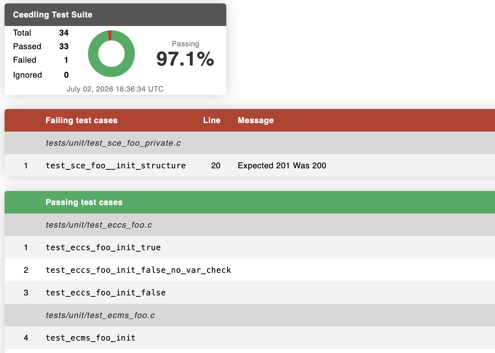

# 🌱 Ceedling Changelog

This format is based on [Keep a Changelog](https://keepachangelog.com/en/1.1.0/), and this project adheres to [Semantic Versioning](https://semver.org/spec/v2.0.0.html).

This changelog is complemented by three other documents:

1. 🔊 **[Release Notes](ReleaseNotes.md)** for announcements, education, and acknowledgements.
1. 💔 **[Breaking Changes](BreakingChanges.md)** for a list of impacts to existing Ceedling projects.
1. 🐛 **[Known Issues](KnownIssues.md)** for a list of presently known problems and limitations.

---

# [1.2.0] — 2026-10-21

## 🌟 Added

### Delta builds
[Delta builds](https://docs.throwtheswitch.org/Ceedling/1.2.0/getting-started/builds/) have been restored after a temporary hiatus following a major refactoring for 1.0.0 ([Restore delta test builds to Ceedling 1.0.0+](https://github.com/ThrowTheSwitch/Ceedling/issues/1143)).

A [delta build](https://docs.throwtheswitch.org/Ceedling/1.2.0/getting-started/builds/#delta-build-overview) is simply a build run that only performs regeneration, compilation, linking, or execution as needed because of changed files or configuration. Ceedling 1.0.0 introduced [threaded parallel build steps](https://docs.throwtheswitch.org/Ceedling/1.2.0/configuration/parallel-builds/) but had to remove [delta builds](https://docs.throwtheswitch.org/Ceedling/1.2.0/getting-started/builds/) in the process. As of 1.2.0, both build speedups are now available. [Delta builds](https://docs.throwtheswitch.org/Ceedling/1.2.0/getting-started/builds/) are automatic with no configuration needed.

If a build requests a test to be built/run but no changes for it exist, its cached test results will be reported. The [`--force-test-rerun`](https://docs.throwtheswitch.org/Ceedling/1.2.0/getting-started/command-line/#ceedling-build-tasks) flag is available at the command line for any test-related tasks to force the [delta build](https://docs.throwtheswitch.org/Ceedling/1.2.0/getting-started/builds/#delta-build-special-cases) mechanism to rerun test executables and produce new test results.

[Delta builds](https://docs.throwtheswitch.org/Ceedling/1.2.0/getting-started/builds/) are fully integrated with test build plugins (e.g. [GCov](https://docs.throwtheswitch.org/Ceedling/1.2.0/plugins/gcov/), [Valgrind](https://docs.throwtheswitch.org/Ceedling/1.2.0/plugins/valgrind/)). Each runs its own build through the same test pipeline as an ordinary test build, under its own build context, so it benefits from the same staleness tracking within its own isolated dependency cache

### `#include` relative paths & duplicate filename disambiguation
Added support for properly [distinguishing all C files by filepath](https://docs.throwtheswitch.org/Ceedling/1.2.0/testing-guide/conventions/#distinguishing-same-named-files) (addressing [#1167](https://github.com/ThrowTheSwitch/Ceedling/issues/1167) specifically but also the fundamental problem generally).

In Ceedling’s early history simplicity won out with the assumption that every C file would be uniquely named. But, for example, this meant _dir1/foo.h_ and _dir2/foo.h_ were indistiguishable and Ceedling “guessed” to disambiguate using the ordering of filepath collections. This worked, but there was no ability to use partial paths to explicitly select a specific file. Now Ceedling fully utilizes filepaths to distinguish all elements of a test build. [Relative paths are supported in `#include` directives](https://docs.throwtheswitch.org/Ceedling/1.2.0/testing-guide/conventions/#distinguishing-same-named-files). [`test:` build tasks](https://docs.throwtheswitch.org/Ceedling/1.2.0/getting-started/command-line/#ceedling-testpath) at the command line can optionally include a filepath to distinguish test files of the same name. The previous convention still works where the ordering of paths is identical among [compiler search paths](https://docs.throwtheswitch.org/Ceedling/1.2.0/testing-guide/conventions/#test-build-search-paths) and those used to find files for test builds, but now additional path information can be provided to target specific files in your source collection.

### Partials filepaths & duplicate module name disambiguation
[#1311](https://github.com/ThrowTheSwitch/Ceedling/issues/1311) Added [directory-qualified Partial directive macros](https://docs.throwtheswitch.org/Ceedling/1.2.0/testing-guide/partials/directives/#naming-a-module-by-directory) so [Partials](https://docs.throwtheswitch.org/Ceedling/1.2.0/testing-guide/partials/) share the filepath handling the rest of a test build gained in this release (see previous section).

Previously, [Partial directive macros](https://docs.throwtheswitch.org/Ceedling/1.2.0/testing-guide/partials/directives/) took only a bare module name with no means to provide path information to distinguish modules of the same name. Every Partials [`_MODULE` and `_CONFIG` macro](https://docs.throwtheswitch.org/Ceedling/1.2.0/testing-guide/partials/directives/#partials-function-selection-by-macro) now has an `_AT` variant taking that module’s directory as a separate first argument (e.g. [`TEST_PARTIAL_PRIVATE_MODULE_AT(sensors/soil, Calibration)`](https://docs.throwtheswitch.org/Ceedling/1.2.0/testing-guide/partials/directives/#naming-a-module-by-directory)). As with [`#include` directives](https://docs.throwtheswitch.org/Ceedling/1.2.0/testing-guide/conventions/#distinguishing-same-named-files) elsewhere, the directory is matched against the trailing end of a real file’s path. [Supply only as much of it](https://docs.throwtheswitch.org/Ceedling/1.2.0/testing-guide/partials/directives/#how-much-path-to-supply) as it takes to name the module you mean. A bare module name in the original macros continues to work unchanged.

A test file can now **test** two same-named modules together, and it can **mock** both of them too (see the next section).

### Mocking same-named headers by directory
A test file can now mock two headers that share a filename, such as `drivers/uart/config.h` and `drivers/spi/config.h`, by including each mock through its folder (`#include "drivers/uart/mock_config.h"`). This works for [traditional mocks](https://docs.throwtheswitch.org/Ceedling/1.2.0/testing-guide/frameworks/#cmock-configuration), [`MOCK_PARTIAL_*_MODULE_AT()` Partials](https://docs.throwtheswitch.org/Ceedling/1.2.0/testing-guide/partials/directives/#naming-a-module-by-directory), and the [FFF plugin’s fakes](https://docs.throwtheswitch.org/Ceedling/1.2.0/plugins/fff/#fakes-of-same-named-headers). The new [`:cmock` ↳ `:mock_name_include_folder`](https://docs.throwtheswitch.org/Ceedling/1.2.0/configuration/reference/cmock/#mock_name_include_folder) setting, enabled by default, names each mock’s internals by that folder so the two mocks no longer collide. It relies on matching features in [CMock](https://docs.throwtheswitch.org/Ceedling/1.2.0/overview/tools-and-frameworks/#cmock) and [Unity](https://docs.throwtheswitch.org/Ceedling/1.2.0/overview/tools-and-frameworks/#unity), which Ceedling’s vendored copies include.

### Multiple file extensions per file type
Added support for multiple [file extensions](https://docs.throwtheswitch.org/Ceedling/1.2.0/configuration/reference/extension/) per type (e.g. [`:extension` ↳ `:source`](https://docs.throwtheswitch.org/Ceedling/1.2.0/configuration/reference/extension/#source) ⇒ `['.c', '.C']`) such as requested in [#947](https://github.com/ThrowTheSwitch/Ceedling/issues/947).

### Dedicated mocks and test runner generation build tasks
Some users have asked for the ability to run the [test build pipeline](https://docs.throwtheswitch.org/Ceedling/1.2.0/getting-started/command-line/#ceedling-build-tasks) only up through generating mocks or test runners without running the rest of a build. This is now possible.

Tasks mirroring [command line `test:` task invocation](https://docs.throwtheswitch.org/Ceedling/1.2.0/getting-started/command-line/#ceedling-test) but with an early termination like [`test:build_only`](https://docs.throwtheswitch.org/Ceedling/1.2.0/getting-started/command-line/#ceedling-testbuild_only) now exist:

* [`gen:mocks:<test>`](https://docs.throwtheswitch.org/Ceedling/1.2.0/getting-started/command-line/#ceedling-genmocks)
* [`gen:test_runner:<test>`](https://docs.throwtheswitch.org/Ceedling/1.2.0/getting-started/command-line/#ceedling-gentest_runner)

Like with [command line `test:` tasks](https://docs.throwtheswitch.org/Ceedling/1.2.0/getting-started/command-line/#ceedling-test), `<test>` can be `all`, a test file name, or a source file name that has a corresponding test file.

### Test build fallback preprocessing improvements
If your toolchain’s preprocessor lacks certain features, Ceedling still attempts to extract information and code from C files through [fallback text processing](https://docs.throwtheswitch.org/Ceedling/1.2.0/testing-guide/conventions/#fallback-test-build-preprocessing). In 1.1.0 this was exposed as a [project configuration option](https://docs.throwtheswitch.org/Ceedling/1.2.0/configuration/reference/test-build/#preprocess_force_fallback) mostly for Ceedling’s self-tests and also noted as a possible option should Ceedling’s [probe for toolchain preprocessor features](https://docs.throwtheswitch.org/Ceedling/1.2.0/testing-guide/conventions/#fallback-test-build-preprocessing) ever provide a false positive.

In 1.2.0, [fallback preprocessing](https://docs.throwtheswitch.org/Ceedling/1.2.0/testing-guide/conventions/#fallback-test-build-preprocessing) can now sometimes be used in projects with simple conditional compilation (e.g. `#ifdef`) as a faster alternative to [full toolchain preprocessing](https://docs.throwtheswitch.org/Ceedling/1.2.0/testing-guide/conventions/#test-preprocessing). A test file’s [`#include`s](https://docs.throwtheswitch.org/Ceedling/1.2.0/testing-guide/conventions/#preprocessing-for-include-directives) are now checked against a plain run of your toolchain’s preprocessor. A mock in an `#if` branch that is off no longer stops a build or replaces the real module it guards. [Fallback preprocessing](https://docs.throwtheswitch.org/Ceedling/1.2.0/testing-guide/conventions/#fallback-test-build-preprocessing) remains a best effort with no guarantees. Error messages will indicate if [fallback preprocessing](https://docs.throwtheswitch.org/Ceedling/1.2.0/testing-guide/conventions/#fallback-test-build-preprocessing) is insufficient for your project’s preprocessing needs.

Force fallback preprocessing with [`:test_build` ↳ `:preprocess_force_fallback`](https://docs.throwtheswitch.org/Ceedling/1.2.0/configuration/reference/test-build/#preprocess_force_fallback) but **_be sure to understand [Ceedling’s test preprocessing](https://docs.throwtheswitch.org/Ceedling/1.2.0/testing-guide/conventions/#test-preprocessing) before doing so_**.

### Test case shuffling at runtime
Ceedling now integrates [Unity’s](https://docs.throwtheswitch.org/Ceedling/1.2.0/overview/tools-and-frameworks/#unity) features for randomizing test case execution within a test executable ([PR #1041](https://github.com/ThrowTheSwitch/Ceedling/pull/1041) via [`:unity` ↳ `:shuffle_tests`](https://docs.throwtheswitch.org/Ceedling/1.2.0/configuration/reference/unity/#shuffle_tests) ⇒ `TRUE`. If enabled, the behavior of [delta builds](https://docs.throwtheswitch.org/Ceedling/1.2.0/getting-started/builds/) automatically adjusts to always execute test executables even if no code changes have occurred. This ensures the randomization occurs when test executables would otherwise fail to run for lack of any code or configuration changes up the dependency tree.

### Subtractive paths in `TEST_SOURCE_FILE()`
The [`TEST_SOURCE_FILE()` build directive macro](https://docs.throwtheswitch.org/Ceedling/1.2.0/testing-guide/build-directives/#test_source_file-subtractive-notation) can now be used to remove source files from a test executable build using the same `-:` filepath decorator as available in [`:paths`](https://docs.throwtheswitch.org/Ceedling/1.2.0/configuration/reference/paths/#subtractive-entries) project configuration (ex. `TEST_SOURCE_FILE("-:foo/bar/file.c")`). This can be handy in overriding [Ceedling’s conventions](https://docs.throwtheswitch.org/Ceedling/1.2.0/testing-guide/build-directives/#test_source_file-the-headersource-convention) for associating source files with a test executable if your project structure does not match up with Ceedling’s conventions.

### `ceedling.yml` as an alternate default project file
[#1250](https://github.com/ThrowTheSwitch/Ceedling/issues/1250) [`ceedling.yml`](https://docs.throwtheswitch.org/Ceedling/1.2.0/configuration/loading/#default-project-file-in-your-working-directory) is now recognized as an alternate default project filename alongside `project.yml`. Either name is loaded the same way; neither is preferred over the other. If both exist in the same directory, Ceedling raises an error. [`ceedling new`](https://docs.throwtheswitch.org/Ceedling/1.2.0/getting-started/command-line/#ceedling-new-dest) continues to generate `project.yml` by default; pass `--ceedling-yml` to generate `ceedling.yml` instead. See [Loading a Project Configuration](https://docs.throwtheswitch.org/Ceedling/1.2.0/configuration/loading/).

### `ceedling dumpconfig` gains a `--stdout` option
Running the [`dumpconfig`](https://docs.throwtheswitch.org/Ceedling/1.2.0/getting-started/command-line/#ceedling-dumpconfig-filepath-sections) application command to produce a fully resolved project configuration now supports an option to send the resulting YAML directly to `$stdout` instead of a filepath. This is one small step towards Ceedling support for working with other tooling (e.g. agentic coding tools) in future releases.

### Gcov plugin
#### Gcovr raw custom arguments
[#1159](https://github.com/ThrowTheSwitch/Ceedling/issues/1159) Added [`:gcov` ↳ `:gcovr` ↳ `:custom_args:`](https://docs.throwtheswitch.org/Ceedling/1.2.0/plugins/gcov/gcovr/#custom_args), a list of raw command line arguments passed straight through to `gcovr`. This is an escape hatch for any `gcovr` flag Ceedling has no named option for (e.g. limiting gcovr’s search root), mirroring the [`:report_generator` ↳ `:custom_args:`](https://docs.throwtheswitch.org/Ceedling/1.2.0/plugins/gcov/reportgenerator/#custom_args) option that already existed for the ReportGenerator side of the [Gcov plugin](https://docs.throwtheswitch.org/Ceedling/1.2.0/plugins/gcov/). Unlike every other GCovr option, `:custom_args:` still applies even when [`:config_file`](https://docs.throwtheswitch.org/Ceedling/1.2.0/plugins/gcov/gcovr/#config_file) is set.

#### Gcovr JaCoCo and LCOV reports
[#963](https://github.com/ThrowTheSwitch/Ceedling/issues/963) Added [`JaCoCo`](https://docs.throwtheswitch.org/Ceedling/1.2.0/plugins/gcov/gcovr/#jacoco-xml-reports) to the [Gcov plugin’s `:reports`](https://docs.throwtheswitch.org/Ceedling/1.2.0/plugins/gcov/reporting/), a JaCoCo XML coverage report generated by `gcovr` and importable by IDEs such as CLion. The existing `lcov` report, previously generated only by [ReportGenerator](https://docs.throwtheswitch.org/Ceedling/1.2.0/plugins/gcov/reportgenerator/), is now also generated by [`gcovr`](https://docs.throwtheswitch.org/Ceedling/1.2.0/plugins/gcov/gcovr/#lcov-reports). Both require `gcovr` 7.0 or higher and come with options for [pretty-printing](https://docs.throwtheswitch.org/Ceedling/1.2.0/plugins/gcov/gcovr/#jacoco_pretty), [LCOV comments](https://docs.throwtheswitch.org/Ceedling/1.2.0/plugins/gcov/gcovr/#lcov_comment) and [test names](https://docs.throwtheswitch.org/Ceedling/1.2.0/plugins/gcov/gcovr/#lcov_test_name), and [artifact filenames](https://docs.throwtheswitch.org/Ceedling/1.2.0/plugins/gcov/gcovr/#jacoco_artifact_filename).

#### ReportGenerator coverage-threshold parity
Added `:gcov` ↳ `:report_generator` ↳ [`:fail_under_line`](https://docs.throwtheswitch.org/Ceedling/1.2.0/plugins/gcov/reportgenerator/#fail_under_line)/[`:fail_under_branch`](https://docs.throwtheswitch.org/Ceedling/1.2.0/plugins/gcov/reportgenerator/#fail_under_branch)/[`:fail_under_method`](https://docs.throwtheswitch.org/Ceedling/1.2.0/plugins/gcov/reportgenerator/#fail_under_method)/[`:fail_under_full_method`](https://docs.throwtheswitch.org/Ceedling/1.2.0/plugins/gcov/reportgenerator/#fail_under_full_method), ReportGenerator’s own coverage-threshold options mirroring the Gcovr side’s existing [`:fail_under_*`](https://docs.throwtheswitch.org/Ceedling/1.2.0/plugins/gcov/gcovr/#fail_under_line) family. A configured threshold breaks the build in the same way as these options do with Gcovr.

### Bullseye plugin
The [Bullseye code coverage plugin](https://docs.throwtheswitch.org/Ceedling/1.2.0/plugins/bullseye/) using the commercial [Bullseye](https://www.bullseye.com/) tool is enabled again (disabled since 1.0.0). The makers of Bullseye generously provided a license in order to modernize the plugin.

The refreshed Bullseye plugin offers additional features over the original version including support for [branch coverage detail](https://docs.throwtheswitch.org/Ceedling/1.2.0/plugins/bullseye/#branch_detail), [machine-readable coverage reports (XML flavors)](https://docs.throwtheswitch.org/Ceedling/1.2.0/plugins/bullseye/#xml_report), and an optional [coverage threshold](https://docs.throwtheswitch.org/Ceedling/1.2.0/plugins/bullseye/#fail_under) that will break a test build.

### Sanitize plugin
The new [Sanitize plugin](https://docs.throwtheswitch.org/Ceedling/1.2.0/plugins/sanitize/) builds and runs tests with the compiler’s sanitizers. [`sanitize:all`](https://docs.throwtheswitch.org/Ceedling/1.2.0/plugins/sanitize/#usage) and its sibling tasks run [AddressSanitizer](https://clang.llvm.org/docs/AddressSanitizer.html), [UndefinedBehaviorSanitizer](https://clang.llvm.org/docs/UndefinedBehaviorSanitizer.html), and [LeakSanitizer](https://clang.llvm.org/docs/LeakSanitizer.html) in a build of their own, and [`:sanitize` ↳ `:test_builds`](https://docs.throwtheswitch.org/Ceedling/1.2.0/plugins/sanitize/#test_builds) instruments ordinary `test:` builds as well. The plugin’s flags never reach another plugin’s build, such as [Gcov](https://docs.throwtheswitch.org/Ceedling/1.2.0/plugins/gcov/) or [Valgrind](https://docs.throwtheswitch.org/Ceedling/1.2.0/plugins/valgrind/). A test a sanitizer stops fails with [its finding named](https://docs.throwtheswitch.org/Ceedling/1.2.0/plugins/sanitize/#how-findings-are-reported), such as `AddressSanitizer heap-buffer-overflow at test/test_buffer.c:21`, while a leak is reported as a finding without disturbing test results. Each test’s sanitizer reports are kept in a [log of its own](https://docs.throwtheswitch.org/Ceedling/1.2.0/plugins/sanitize/#artifacts), [`:reports`](https://docs.throwtheswitch.org/Ceedling/1.2.0/plugins/sanitize/#reports) writes text, JSON, and SARIF reports, and [`:fail_build`](https://docs.throwtheswitch.org/Ceedling/1.2.0/plugins/sanitize/#fail_build) fails the build on any finding. The plugin runs on Linux and macOS; leak detection is Linux only.

### Valgrind plugin

- Added [`:valgrind` ↳ `:suppressions:`](https://docs.throwtheswitch.org/Ceedling/1.2.0/plugins/valgrind/#suppressions), a list of Valgrind suppression files. Previously these had to be hand-injected into [`:arguments:`](https://docs.throwtheswitch.org/Ceedling/1.2.0/plugins/valgrind/#arguments).
- Added [`:valgrind` ↳ `:xml_report:`](https://docs.throwtheswitch.org/Ceedling/1.2.0/plugins/valgrind/#xml_report) to write a machine-readable report per test executable alongside the text log, for CI systems or other tooling to consume Valgrind output directly.

### Cppcheck plugin

- Added [`:cppcheck` ↳ `:fail_build:`](https://docs.throwtheswitch.org/Ceedling/1.2.0/plugins/cppcheck/#fail_build) and [`:fail_build_severities:`](https://docs.throwtheswitch.org/Ceedling/1.2.0/plugins/cppcheck/#fail_build_severities) to break a build on findings. Cppcheck exits successfully even when it finds defects, so [`cppcheck:all`](https://docs.throwtheswitch.org/Ceedling/1.2.0/plugins/cppcheck/#analyze-whole-project) previously could not fail a build at all. Only `error` severity fails by default, since whole project analysis always enables every check.
- [`cppcheck:all`](https://docs.throwtheswitch.org/Ceedling/1.2.0/plugins/cppcheck/#analyze-whole-project) now prints a per-severity tally of findings. Results previously landed only in report files, with nothing shown at the console.

### Module Generator plugin

- [#695](https://github.com/ThrowTheSwitch/Ceedling/issues/695) Added [`module:test[...]`](https://docs.throwtheswitch.org/Ceedling/1.2.0/plugins/module-generator/#testing-from-headers), which writes a test file holding an ignored test for each function a module’s header declares. Run again, it adds tests only for newly declared functions.
- [#665](https://github.com/ThrowTheSwitch/Ceedling/issues/665) Added [`:test_guard`](https://docs.throwtheswitch.org/Ceedling/1.2.0/plugins/module-generator/#test-guards) to wrap generated tests in `#if` rather than `#ifdef`. Generating tests now warns when the guarding [test define](https://docs.throwtheswitch.org/Ceedling/1.2.0/plugins/module-generator/#test-defines) is not defined for test builds, since those tests would compile to nothing.
- [#1025](https://github.com/ThrowTheSwitch/Ceedling/issues/1025) [`module:create`](https://docs.throwtheswitch.org/Ceedling/1.2.0/plugins/module-generator/#overview) now warns about each [existing file elsewhere in the project that shares a name](https://docs.throwtheswitch.org/Ceedling/1.2.0/plugins/module-generator/#same-named-files) with a file it creates.

### Dependencies plugin executables
[#1110](https://github.com/ThrowTheSwitch/Ceedling/issues/1110) A dependency can now list the programs it builds under [`:artifacts` ↳ `:executables`](https://docs.throwtheswitch.org/Ceedling/1.2.0/plugins/dependencies/#executables) for tools rather than libraries. A release build or [`dependencies:make`](https://docs.throwtheswitch.org/Ceedling/1.2.0/plugins/dependencies/#ceedling-dependenciesmake) builds them when missing, test builds do not wait on them, and they are never linked. [`dependencies:deploy`](https://docs.throwtheswitch.org/Ceedling/1.2.0/plugins/dependencies/#ceedling-dependenciesdeploy) copies them, along with [dynamic libraries](https://docs.throwtheswitch.org/Ceedling/1.2.0/plugins/dependencies/#dynamic_libraries), to a new optional [`:paths` ↳ `:deploy`](https://docs.throwtheswitch.org/Ceedling/1.2.0/plugins/dependencies/#working-paths) folder, by default beside the release executable.

### Build warnings plugin context, deduplication, and filtering
The [Build Warnings Log plugin](https://docs.throwtheswitch.org/Ceedling/1.2.0/plugins/report-build-warnings-log/) now logs each GCC or Clang warning with the lines that explain it — the function or include context before it along with the source line, caret, and any note after it. Each distinct warning is logged once per build context, so a header's warning appears once rather than once per file including it, and compiler summary lines are left out. New [`:patterns`](https://docs.throwtheswitch.org/Ceedling/1.2.0/plugins/report-build-warnings-log/#patterns) and [`:excludes`](https://docs.throwtheswitch.org/Ceedling/1.2.0/plugins/report-build-warnings-log/#excludes) settings optionally take regular expressions that replace the default match of any line mentioning “warning” and optionally drop warnings you have already accepted or prevent false positives.

### Build warnings plugin SARIF and JSON reports
The [Build Warnings Log plugin](https://docs.throwtheswitch.org/Ceedling/1.2.0/plugins/report-build-warnings-log/#reports) can now write its warnings as [SARIF](https://docs.throwtheswitch.org/Ceedling/1.2.0/plugins/report-build-warnings-log/#sarif-report) and [JSON](https://docs.throwtheswitch.org/Ceedling/1.2.0/plugins/report-build-warnings-log/#json-report) reports alongside, or instead of, its plain [text log](https://docs.throwtheswitch.org/Ceedling/1.2.0/plugins/report-build-warnings-log/#text-report). SARIF, the standard format for static analysis results, lets GitHub code scanning, Azure DevOps, SonarQube, Jenkins, and IDE viewers show each warning on the line it concerns. The [JSON report](https://docs.throwtheswitch.org/Ceedling/1.2.0/plugins/report-build-warnings-log/#json-report) lists each warning’s file, line, column, severity, flag, message, and context for scripts. The new [`:reports`](https://docs.throwtheswitch.org/Ceedling/1.2.0/plugins/report-build-warnings-log/#reports) setting selects any of `:text`, `:sarif`, and `:json`, and defaults to `:text`. The structured reports are written for every build context that ran a build step, even without warnings, so a CI step always finds its file.

### JUnit report plugin test locations
[#583](https://github.com/ThrowTheSwitch/Ceedling/issues/583) The [Test Suite Report Log Factory plugin](https://docs.throwtheswitch.org/Ceedling/1.2.0/plugins/report-tests-log-factory/#junit-test-locations)’s [JUnit report](https://docs.throwtheswitch.org/Ceedling/1.2.0/plugins/report-tests-log-factory/#junit-xml-format) now says where each test case lives. Each `<testcase>` carries `classname`, `file`, and `line` attributes, and a failure’s message starts with its file and line (e.g. `test/TestUsartModel.c:44: ...`). CI tools such as GitLab can then link a result to its code. `classname` keeps the test file’s path so same-named test files in different folders stay distinct. The new [`:junit` ↳ `:file_line_anchor`](https://docs.throwtheswitch.org/Ceedling/1.2.0/plugins/report-tests-log-factory/#junit-test-locations) option writes `file` as `path#line` for tools that follow that form.

### GTest-like report plugin skipped tests
The [GTest-like console report](https://docs.throwtheswitch.org/Ceedling/1.2.0/plugins/report-tests-gtestlike-stdout/) (`report_tests_gtestlike_stdout`) now reports a Unity test ignored with `TEST_IGNORE()` or `TEST_IGNORE_MESSAGE()` as a [GoogleTest skipped test](https://docs.throwtheswitch.org/Ceedling/1.2.0/plugins/report-tests-gtestlike-stdout/#googletest-skip-support-and-its-consumers). A skipped test is listed with its location and message, counted in the run, and summarized between passed and failed tests, the way GoogleTest 1.10.0 and later reports `GTEST_SKIP()`. A test file whose every test is ignored now gets its own section. The new [`:report_tests_gtestlike_stdout` ↳ `:ignored_as_skipped:`](https://docs.throwtheswitch.org/Ceedling/1.2.0/plugins/report-tests-gtestlike-stdout/#configuration) setting defaults to `TRUE`. Set it to `FALSE` to leave ignored tests out of the report for tools that do not understand skipped tests (see the related _Changed_ entry below).

### IDE report plugin formats
[#633](https://github.com/ThrowTheSwitch/Ceedling/issues/633) The [IDE console report](https://docs.throwtheswitch.org/Ceedling/1.2.0/plugins/report-tests-ide-stdout/) (`report_tests_ide_stdout`) now lists failed and ignored tests in the shape of [GCC diagnostics](https://docs.throwtheswitch.org/Ceedling/1.2.0/plugins/report-tests-ide-stdout/#plugin-overview) (e.g. `test/TestModel.c:21:1: error: testInit: Expected 5 Was 4`). [Eclipse CDT](https://docs.throwtheswitch.org/Ceedling/1.2.0/plugins/report-tests-ide-stdout/#eclipse-cdt), [VS Code](https://docs.throwtheswitch.org/Ceedling/1.2.0/plugins/report-tests-ide-stdout/#vs-code), [CLion](https://docs.throwtheswitch.org/Ceedling/1.2.0/plugins/report-tests-ide-stdout/#clion), and other tools that read GCC output show each failure as an error and each ignored test as a warning, linked to the test. The new [`:report_tests_ide_stdout` ↳ `:format`](https://docs.throwtheswitch.org/Ceedling/1.2.0/plugins/report-tests-ide-stdout/#format) setting defaults to `:gcc`. [`:legacy`](https://docs.throwtheswitch.org/Ceedling/1.2.0/plugins/report-tests-ide-stdout/#format) restores the earlier, simpler lines. `:vscode`, `:eclipse`, and `:clion` name the settings each IDE needs. The plugin documentation now covers [set up for each of these IDEs](https://docs.throwtheswitch.org/Ceedling/1.2.0/plugins/report-tests-ide-stdout/#ide-setup) (see the related _Changed_ entry below).

### Filepath limit checks
Platform filepath limits (especially on Windows) can lead to mysterious build failures, especially in CI where deep project subdirectories can occur. To help track down funny business, filepaths are intercepted and their lengths logged if they are nearing or exceed the platform limit.

### Retry handling for child process generated file dependencies
In certain intervening circumstances, particularly on Windows, a child process may successfully generate a file that Ceedling expects to be present but OS-related issues (e.g. virus software, security checks, cloud storage syncing) delay from actually appearing in the file system. A new application-wide retry mechanism deals with the situations and fails properly if the delay exceeds the retry limit.

### Windows test executable manifests
[#146](https://github.com/ThrowTheSwitch/Ceedling/issues/146) [#116](https://github.com/ThrowTheSwitch/Ceedling/issues/116) On Windows, Ceedling now writes a manifest beside each test executable to help ensure that [any test filename can be run](https://docs.throwtheswitch.org/Ceedling/1.2.0/testing-guide/conventions/#installer-like-test-filenames-on-windows). The Installer Detection feature of User Account Control (UAC) otherwise demands administrator privileges for an executable whose name contains _install_, _setup_, _update_, or _patch_. A test filename containing one of these words is noted with a warning. Note that modern Windows compiler toolchains tend to
embed a manifest that prevents the privilege limitation; Ceedling’s external manifest is further insurance.

## 💪 Fixed

Note: 1.2.0 includes all bug fixes for 1.1.x.

- A CLI parameter string mutation issue that could corrupt certain build or plugin task invocations.
- Fixed a Unity `TEST_IGNORE_MESSAGE()` test case being misreported as crash evidence during crash-diagnosis retries when it shares a test file with a genuine crash.
- [#104](https://github.com/ThrowTheSwitch/Ceedling/issues/104) Fixed a literal `[` or `]` in a path being silently misread as a [glob](https://docs.throwtheswitch.org/Ceedling/1.2.0/configuration/reference/paths/#paths-globs) or regular expression syntax. This could drop files from a build with no error, cause issues with a [`:build_root`](https://docs.throwtheswitch.org/Ceedling/1.2.0/configuration/reference/project/#build_root) entry, or cause a passing test run to be reported as "no tests executed."
- [#1083](https://github.com/ThrowTheSwitch/Ceedling/issues/1083) Fixed a test file’s `#include` of a mock being dropped with [`:use_test_preprocessor`](https://docs.throwtheswitch.org/Ceedling/1.2.0/configuration/reference/project/#use_test_preprocessor) set to `:tests` or `:all` when an `#ifdef` or `#if` around it depended on a [macro defined in a header](https://docs.throwtheswitch.org/Ceedling/1.2.0/testing-guide/conventions/#where-the-macros-deciding-an-include-come-from). The mock was never generated, and the build stopped on a missing mock header. The macro now decides the `#include` as it will at compile time, whether it reaches the test file through a header the test includes directly or through one it mocks.
- [#1267](https://github.com/ThrowTheSwitch/Ceedling/issues/1267) Fixed a conditional `#include` whose target is a macro invocation (e.g. `#include DEVICE_HEADER(x)`) being silently dropped from [includes extraction](https://docs.throwtheswitch.org/Ceedling/1.2.0/testing-guide/conventions/#preprocessing-for-include-directives) whenever its own guard condition depended on a symbol defined in another header.
- [#1292](https://github.com/ThrowTheSwitch/Ceedling/issues/1292) Fixed an intermittent `Errno::ENOTDIR`/`EISDIR` crash when automatically vendoring Unity, CMock, and CException into a project’s build directory, caused by a transient file-system race (e.g. an antivirus/EDR lock, a cloud-sync filter driver, or a second concurrent Ceedling invocation). The copy step now retries transient races and self-heals a stale, wrong-typed leftover from a previous failed copy.
- Fixed a rare, Ruby-version- and platform-dependent misordering of include lists and mixin environment variable resolution caused by relying on `sort`/`sort_by`’s ordering among tied elements, which Ruby does not guarantee to be stable.
- Fixed two source files of the same name in one test executable sharing a single preprocessed intermediate file, so whichever was preprocessed second overwrote the first. Preprocessed files now mirror their source’s own directory, matching the convention compiled objects already follow.
- Fixed a generated header’s fallback `#include` guard being built from a filename alone, so two same-named headers in one test shared one guard and whichever the compiler read second was emptied of its declarations.
- Fixed a local release gem build packaging leftover build output from the machine that built it, including compiled object files and executables. Fixed the same packaging omitting the configuration file that the test suites bundled with the gem need in order to run at all. Since the release gem is produced in a clean CI environment the underlying issue never affected gems published through GitHub and RubyGems.org.

### Backtrace / `gdb` handling

- Fixed [`:use_backtrace` ⇒ `:gdb`](https://docs.throwtheswitch.org/Ceedling/1.2.0/configuration/reference/project/#gdb) remaining active on a machine where `gdb` cannot actually attach to a process (e.g. lost macOS codesigning trust after a system update or Homebrew upgrade). Previously, Ceedling validated that `gdb` was available but not its ability to probe a process. Ceedling now detects a degraded `gdb` at build startup and falls back to [`:simple`](https://docs.throwtheswitch.org/Ceedling/1.2.0/configuration/reference/project/#simple) automatically, with a prominent warning for the condition.
- Fixed handling for a crashed test executable that `gdb` could not usefully explain looking identical to an ordinary crash report. Ceedling now better detects this and prominently warns when this happens.

### Partials

- Fixed a bare, top-level macro invocation that expands to a full function definition (a common x-macro boilerplate idiom) silently corrupting or losing whatever construct followed it during [Partials](https://docs.throwtheswitch.org/Ceedling/1.2.0/testing-guide/partials/) extraction.
- Fixed a [Partial](https://docs.throwtheswitch.org/Ceedling/1.2.0/testing-guide/partials/) resolving its module’s header and its module’s source independently, which could pair one module’s header with a same-named other module’s source.
- Fixed a [Partialized module’s](https://docs.throwtheswitch.org/Ceedling/1.2.0/testing-guide/partials/) own real header being reachable by its bare filename from inside the [generated Partial](https://docs.throwtheswitch.org/Ceedling/1.2.0/testing-guide/partials/overview/#generated-files), so a Partial could be compiled against a same-named other module’s header.

### Mixins

- Fixed priority / precedence issues with [command line mixin](https://docs.throwtheswitch.org/Ceedling/1.2.0/configuration/mixins/#-mixin-command-line-flags) edge case (same mixin provided multiple times).
- Fixed [mixin environment variable](https://docs.throwtheswitch.org/Ceedling/1.2.0/configuration/mixins/#environment-variables) name matching issues such as a leading zero for `01` numbering or improperly matching on an environment variable similar to the mixin convention.
- Fixed an edge case for [`tools:` argument](https://docs.throwtheswitch.org/Ceedling/1.2.0/configuration/reference/tools/#ceedling-tool-arguments-addition-shortcut) special handling merging involving a single string argument instead of list of arguments.

### Reporting plugins

- Fixed a thread-safety issue in [`report_build_warnings_log`](https://docs.throwtheswitch.org/Ceedling/1.2.0/plugins/report-build-warnings-log/) that could crash a multi-threaded build or produce an incomplete warnings log.
- Fixed the GTest-like console report ([`report_tests_gtestlike_stdout`](https://docs.throwtheswitch.org/Ceedling/1.2.0/plugins/report-tests-gtestlike-stdout/)) mislabeling ignored tests as passing and silently dropping their ignore message; its header and footer test counts could also disagree whenever a build had ignored tests.
- Fixed the TeamCity console report ([`report_tests_teamcity_stdout`](https://docs.throwtheswitch.org/Ceedling/1.2.0/plugins/report-tests-teamcity-stdout/)) not escaping a real line break in a failure message, corrupting the TeamCity service message it produced.

#### `report_tests_log_factory`
- Fixed [`report_tests_log_factory`](https://docs.throwtheswitch.org/Ceedling/1.2.0/plugins/report-tests-log-factory/)’s [JUnit](https://docs.throwtheswitch.org/Ceedling/1.2.0/plugins/report-tests-log-factory/#junit-xml-format), [CppUnit](https://docs.throwtheswitch.org/Ceedling/1.2.0/plugins/report-tests-log-factory/#cppunit-xml-format), and [HTML](https://docs.throwtheswitch.org/Ceedling/1.2.0/plugins/report-tests-log-factory/#html-format) reports producing malformed or unsafe output when processing characters like `<`, `>`, `&`, or `"`.
- Fixed [`report_tests_log_factory`](https://docs.throwtheswitch.org/Ceedling/1.2.0/plugins/report-tests-log-factory/) report content silently depending on the order reports were listed in [`:report_tests_log_factory` ↳ `:reports:`](https://docs.throwtheswitch.org/Ceedling/1.2.0/plugins/report-tests-log-factory/#configuration) (e.g. enabling `junit` ahead of `cppunit`)

### Module Generator plugin

- Fixed a [path hint](https://docs.throwtheswitch.org/Ceedling/1.2.0/plugins/module-generator/#path-hints) carrying over from one module to the next when a call names several, such as [`module:create[lab:First,Second]`](https://docs.throwtheswitch.org/Ceedling/1.2.0/plugins/module-generator/#patterns).
- Fixed several [ordered hints](https://docs.throwtheswitch.org/Ceedling/1.2.0/plugins/module-generator/#path-hints) such as `lab:secret:lair` creating a file named `secret:lair` rather than matching nested folders. A Windows drive letter in a hint now stays part of its path.
- Fixed a hint failing the whole command when it matched no path of one kind. Files of that kind now go to its [first path](https://docs.throwtheswitch.org/Ceedling/1.2.0/plugins/module-generator/#default-paths), and only a hint matching nothing at all stops the command. Headers go with the source when no include paths are listed.
- Fixed any name beginning with `test` being taken as a test file, turning `testimony` into `imony`. Only a name carrying the configured [`:test_file_prefix`](https://docs.throwtheswitch.org/Ceedling/1.2.0/configuration/reference/project/#test_file_prefix) asks for a test file alone.
- Fixed [`module:stub`](https://docs.throwtheswitch.org/Ceedling/1.2.0/plugins/module-generator/#stubbing) ignoring the project’s [`:cmock`](https://docs.throwtheswitch.org/Ceedling/1.2.0/configuration/reference/cmock/) settings and a subdirectory named with a slash, printing its configuration, and triggering a CMock warning about [`:includes`](https://docs.throwtheswitch.org/Ceedling/1.2.0/configuration/reference/cmock/#includes).
- Fixed [`:boilerplate_files`](https://docs.throwtheswitch.org/Ceedling/1.2.0/plugins/module-generator/#boilerplate-files) changing the configured [`:boilerplates`](https://docs.throwtheswitch.org/Ceedling/1.2.0/plugins/module-generator/#boilerplates). A boilerplate file that does not exist now stops the command rather than being ignored.

### Command Hooks plugin

- Fixed certain [hooks](https://docs.throwtheswitch.org/Ceedling/1.2.0/plugins/command-hooks/#available-build-step-hooks) handing their tools an empty `${1}`.
- The [compile hooks](https://docs.throwtheswitch.org/Ceedling/1.2.0/plugins/command-hooks/#pre_compile_execute) now pass the source file as `${1}` and the object file as `${2}`, and [`:pre_runner_generate`](https://docs.throwtheswitch.org/Ceedling/1.2.0/plugins/command-hooks/#pre_runner_generate) passes the test file, as documented.
- Fixed a hook configured with a [list of tools](https://docs.throwtheswitch.org/Ceedling/1.2.0/plugins/command-hooks/#tool-lists) failing validation.
- Fixed the build hooks ([`:pre_build`](https://docs.throwtheswitch.org/Ceedling/1.2.0/plugins/command-hooks/#pre_build), [`:post_build`](https://docs.throwtheswitch.org/Ceedling/1.2.0/plugins/command-hooks/#post_build), [`:pre_test_build`](https://docs.throwtheswitch.org/Ceedling/1.2.0/plugins/command-hooks/#pre_test_build), and the like) handing their tools a date string rather than a timestamp in seconds on Windows.

### Dependencies plugin

- Fixed enabling the plugin making its [fetch tools](https://docs.throwtheswitch.org/Ceedling/1.2.0/plugins/dependencies/#fetching-dependencies) (`unzip`, `tar`, `git`, `svn`) and its [`:build_lib`](https://docs.throwtheswitch.org/Ceedling/1.2.0/plugins/dependencies/#building-dependencies) compiler and archiver requirements of every Ceedling command, including plain [`test:all`](https://docs.throwtheswitch.org/Ceedling/1.2.0/getting-started/command-line/#ceedling-testall). Each is now checked just before a dependency fetches or builds with it.
- [#1076](https://github.com/ThrowTheSwitch/Ceedling/issues/1076) Fixed a second [`dependencies:fetch`](https://docs.throwtheswitch.org/Ceedling/1.2.0/plugins/dependencies/#ceedling-dependenciesfetch), or a [`dependencies:make`](https://docs.throwtheswitch.org/Ceedling/1.2.0/plugins/dependencies/#ceedling-dependenciesmake) after a fetch, failing because `git clone` ran into the already-populated folder. A dependency whose fetch path holds files now counts as fetched, and [`dependencies:clean`](https://docs.throwtheswitch.org/Ceedling/1.2.0/plugins/dependencies/#ceedling-dependenciesclean) allows a fresh fetch. [Working paths](https://docs.throwtheswitch.org/Ceedling/1.2.0/plugins/dependencies/#working-paths) are no longer created ahead of fetching, which made a clone into a fetch path containing the build path fail.
- [#1110](https://github.com/ThrowTheSwitch/Ceedling/issues/1110) Fixed [`dependencies:deploy`](https://docs.throwtheswitch.org/Ceedling/1.2.0/plugins/dependencies/#ceedling-dependenciesdeploy) trying to copy a file named for the dependency rather than its dynamic libraries. It now copies every [dynamic library](https://docs.throwtheswitch.org/Ceedling/1.2.0/plugins/dependencies/#dynamic_libraries) from the artifact path beside the release executable.
- Fixed a [`:tar_gzip`](https://docs.throwtheswitch.org/Ceedling/1.2.0/plugins/dependencies/#fetching-dependencies) fetch from an absolute Windows path failing with "Cannot connect to D: resolve failed" where GNU tar, as Git for Windows provides, came first on the path. GNU tar reads a path beginning with a drive letter as a remote host, so `tar` now reads the archive on its standard input.
- Fixed a dependency's [`:environment`](https://docs.throwtheswitch.org/Ceedling/1.2.0/plugins/dependencies/#environment-variables) variables lasting for the rest of the run, reaching every later dependency and Ceedling itself. They now apply only while that dependency's commands run. An entry not of the form `NAME=value`, `NAME+=value`, or `NAME-=value` now stops the build rather than being ignored. Text after `+=` and `-=` now keeps its leading space, so an appended flag can carry the delimiter it needs.
- Fixed a dependency without [`:artifacts`](https://docs.throwtheswitch.org/Ceedling/1.2.0/plugins/dependencies/#artifacts) crashing the build. Configuration problems now stop the build with a message naming the dependency: a missing name, a name without letters or digits, two names sharing a task name, an unknown [fetch method](https://docs.throwtheswitch.org/Ceedling/1.2.0/plugins/dependencies/#fetching-dependencies), or a fetch method missing its `:source` or `:executable`.
- Fixed an [`:includes`](https://docs.throwtheswitch.org/Ceedling/1.2.0/plugins/dependencies/#includes) glob under [`:artifacts`](https://docs.throwtheswitch.org/Ceedling/1.2.0/plugins/dependencies/#artifacts) expanding against the working directory rather than the artifact path, and joining every directory it found into one path.
- Fixed [`:build_lib`](https://docs.throwtheswitch.org/Ceedling/1.2.0/plugins/dependencies/#building-dependencies) depending on the process working directory, and miscomputing where to copy its library when the `:artifact` path was absolute or climbed with `..`. The [`:deps_compiler`](https://docs.throwtheswitch.org/Ceedling/1.2.0/plugins/dependencies/#custom-tools) tool now receives its search paths and defines as `${5}` and `${6}`, like Ceedling's own [compilers](https://docs.throwtheswitch.org/Ceedling/1.2.0/configuration/reference/tools/#tool-element-runtime-substitution-notational-substitution).

### Valgrind & Cppcheck plugins

- Fixed enabling either plugin making its analysis tool a hard dependency of *every* Ceedling command, including plain [`test:all`](https://docs.throwtheswitch.org/Ceedling/1.2.0/getting-started/command-line/#ceedling-testall). Each tool is now required only by its own plugin’s tasks. [`ceedling files:cppcheck`](https://docs.throwtheswitch.org/Ceedling/1.2.0/plugins/cppcheck/#list-suppression-files) no longer needs Cppcheck installed either.

### Valgrind plugin

- Fixed memory errors being undercounted for a test that forks. Valgrind reports a separate error summary for each process it traces, and only the first was counted.
- Fixed a test whose Valgrind report could not be read being treated as a clean result. Ceedling now warns that the memory error status is unknown.
- Fixed the "Wrote N Valgrind report(s)" notice repeating with a different partial count for each test that found errors. It is reported once and counts the reports actually written.
- Fixed settings other than [`:arguments`](https://docs.throwtheswitch.org/Ceedling/1.2.0/plugins/valgrind/#arguments) configured under [`:tools` ↳ `:valgrind`](https://docs.throwtheswitch.org/Ceedling/1.2.0/plugins/valgrind/#configuration) being silently discarded.
- Fixed a `valgrind:` build’s test results report coming up empty. The plugin looked for results where an ordinary `test:` build writes them, not where its own build does.
- Fixed [`--test-case`](https://docs.throwtheswitch.org/Ceedling/1.2.0/getting-started/command-line/#ceedling-test-test-casetest_case_name) and `--exclude_test_case` filters in a `valgrind:` build being handed to Valgrind rather than to the test executable.
- A `valgrind:` task on a platform without Valgrind now explains that Valgrind runs on Linux and other Unix-like systems rather than only reporting a missing executable.

### Cppcheck plugin

- Fixed [`:cppcheck` ↳ `:xml_report_version`](https://docs.throwtheswitch.org/Ceedling/1.2.0/plugins/cppcheck/#xml_report_version) defaulting to a version older Cppcheck releases reject outright, breaking the XML report on common installations. The default is now the version every release accepts.
- Fixed requesting an [`html` report](https://docs.throwtheswitch.org/Ceedling/1.2.0/plugins/cppcheck/#reports) making `cppcheck-htmlreport` mandatory, contradicting that tool’s own optional status.
- Fixed [`cppcheck:all`](https://docs.throwtheswitch.org/Ceedling/1.2.0/plugins/cppcheck/#analyze-whole-project) analyzing nothing and saying nothing when no report is configured, which read like a successful run. The plugin now explains what to configure.
- Fixed a configuration list containing a single non-string entry silently disabling [`#{...}` expansion](https://docs.throwtheswitch.org/Ceedling/1.2.0/configuration/project-file/#inline-ruby-string-expansion) for every other entry in that same list.
- Fixed a misspelled path under [`:paths` ↳ `:cppcheck`](https://docs.throwtheswitch.org/Ceedling/1.2.0/plugins/cppcheck/#suppressions) silently collecting no suppression files, indistinguishable from a directory holding none.

## ⚠️ Changed

### Build warnings plugin `:filename` is a base name
The [Build Warnings Log plugin](https://docs.throwtheswitch.org/Ceedling/1.2.0/plugins/report-build-warnings-log/#filename)’s `:filename` now names the base of each report, and each report adds its own extension (`.log`, `.sarif`, `.json`). Its default is `warnings`, so the text log is still `warnings.log`. A project that sets `:filename` with any extension will have that extension overwritten by the default associated with each report type.

### Module Generator `:naming` takes effect
[#518](https://github.com/ThrowTheSwitch/Ceedling/issues/518) The Module Generator plugin’s [`:naming`](https://docs.throwtheswitch.org/Ceedling/1.2.0/plugins/module-generator/#naming-convention) setting now applies. Previously it had no effect, and every name kept the case typed. [`:naming`](https://docs.throwtheswitch.org/Ceedling/1.2.0/plugins/module-generator/#naming-convention) no longer defaults to `:snake`, so a project that does not set it still sees names kept as typed. [`:bumpy` and `:camel`](https://docs.throwtheswitch.org/Ceedling/1.2.0/plugins/module-generator/#naming-convention) produce the case their documentation describes (`BumpyFiles`, `camelFiles`). A project that sets [`:naming`](https://docs.throwtheswitch.org/Ceedling/1.2.0/plugins/module-generator/#naming-convention) will see generated file names change.

### Performance improvements
Optimizations and fixes have yielded a 5–10% speed increase for most builds _before_ the second-run speedup of the new [delta build](https://docs.throwtheswitch.org/Ceedling/1.2.0/getting-started/builds/) abilities.

### `#include` relative paths & duplicate filename disambiguation in test builds
Because of the support added for handling paths and distinguishing duplicated filenames, the functional interface for testing has changed.

1. The interface for [test-build command line tasks](https://docs.throwtheswitch.org/Ceedling/1.2.0/getting-started/command-line/#ceedling-testpath) has expanded. If you need to distinguish _foo/test_thing.c_ from _bar/test_thing.c_, you must now add a trailing path to disambiguate the tests — `ceedling test:foo/thing` and `ceedling test:bar/thing`. The trailing path is optional and is only required to distinguish test files of the same name in different subdirectories. Of course, the test files must both be in the collection created by your [`:paths`](https://docs.throwtheswitch.org/Ceedling/1.2.0/configuration/reference/paths/) and [`:extension`](https://docs.throwtheswitch.org/Ceedling/1.2.0/configuration/reference/extension/) configurations.
1. Paths in [`#include` directives](https://docs.throwtheswitch.org/Ceedling/1.2.0/testing-guide/conventions/#distinguishing-same-named-files) are optional but available to direct Ceedling to the proper header file for your test build needs. This is especially useful to distinguish header files of the same name in your project. Without a path in an `#include` directive, Ceedling works identically to a compiler, selecting the first file among [ordered search paths](https://docs.throwtheswitch.org/Ceedling/1.2.0/testing-guide/conventions/#test-build-search-paths).

### Use `TEST_SOURCE_FILE()` to override Ceedling’s .c / .h correspondence convention in tests
Historically, Ceedling automatically compiles and links into a test executable any C source file whose name [matches](https://docs.throwtheswitch.org/Ceedling/1.2.0/testing-guide/build-directives/#test_source_file-the-headersource-convention) an `#include`d header file. Sometimes this convention can select the wrong file among same-named files or compile and link an entirely unwanted source file whose name happens to match a header file. Subtractive entries now allow this to be overridden (see more [above](#subtractive-paths-in-test_source_file)).

### Partials no longer silence CMock’s `:treat_inlines` project-wide
[#1247](https://github.com/ThrowTheSwitch/Ceedling/issues/1247) Enabling [`:use_partials`](https://docs.throwtheswitch.org/Ceedling/1.2.0/configuration/reference/project/#use_partials) previously turned off CMock’s `:treat_inlines` ⇒ `:include` option for every mock in every test in your project. This prevented unnecessary overhead and generation of files never used. However, this affected tests that used no Partials at all. Each mock now gets exactly the inline handling it needs on its own terms. A test using [Partials](https://docs.throwtheswitch.org/Ceedling/1.2.0/testing-guide/partials/) gets Partials’ own handling for that mock, while every other mock keeps using whatever `:treat_inlines` setting you’ve configured.

### A mock or Partial silently bypassed by its own real header
[#1240](https://github.com/ThrowTheSwitch/Ceedling/issues/1240) Added handling for edge cases where a mock or [Partial](https://docs.throwtheswitch.org/Ceedling/1.2.0/testing-guide/partials/) could be silently bypassed by the real header these are meant to replace. Idiosyncrasies of C compilation search paths together with combinations of `#include` guards and `#include` ordering can lead to false negative test failures or outright crashes. Ceedling now discovers these scenarios on the other side of test compilation, rewires the test build to isolate the problematic header, and rebuilds with the fix in place. This intervention is only employed for shallow #include scenarios where this action is safe. More complex scenarios are prominently and proactively logged to provide hints on diagnosing failures that require more complex solutions than Ceedling should ever attempt to implement.

### Guidance for a Partial colliding with its own module’s real header
[#1247](https://github.com/ThrowTheSwitch/Ceedling/issues/1247) Ceedling now recognizes when test compilation fails because a [Partial’s generated content](https://docs.throwtheswitch.org/Ceedling/1.2.0/testing-guide/partials/overview/#generated-files) and its source module’s own real, un-Partialized header somehow both reached the compilation of the test fixture translation unit. Logging explains the likely cause and suggested solutions directly alongside the raw compiler error instead of leaving a confusing, bare `redeclaration`/`conflicting types` error.

### Partials generation dependending on fallback preprocessing inadequaices
[Partials generation](https://docs.throwtheswitch.org/Ceedling/1.2.0/testing-guide/conventions/#preprocessing-for-partials) now stops with an error if text-only [fallback preprocessing](https://docs.throwtheswitch.org/Ceedling/1.2.0/testing-guide/conventions/#fallback-test-build-preprocessing) cannot resolve a code element — an `#include` naming a macro or a type behind a conditional expression. The message names the file and line instead of the test build failing later with a confusing compiler or linker error.

### `report_build_warnings_log` plugin warning lines
[`report_build_warnings_log`](https://docs.throwtheswitch.org/Ceedling/1.2.0/plugins/report-build-warnings-log/)’s log files now contain only the actual warning line(s) from a build step’s output, not that step’s entire lengthy console output whenever it happened to contain the word "warning."

### Internal verbosity level mapping for Ceedling to CMock
Ceedling and [CMock](https://docs.throwtheswitch.org/Ceedling/1.2.0/overview/tools-and-frameworks/#cmock) are interdependent but distinct tools. They each perform their own logging and have different verbosity level conventions. The internal mapping has been adjusted to configure CMock for [verbosity levels](https://docs.throwtheswitch.org/Ceedling/1.2.0/configuration/reference/cmock/#verbosity) that match the spirit of the selected top-level Ceedling logging verbosity level.

### Smarter `:flags` and `:defines` matching for preprocessing overrides
Preprocessing [flags](https://docs.throwtheswitch.org/Ceedling/1.2.0/configuration/reference/flags/#flags-test-preprocess) and [defines](https://docs.throwtheswitch.org/Ceedling/1.2.0/configuration/reference/defines/#defines-preprocess) matchers now pass through to test compilation flags and defines for any matchers that are not defined. Previously, any preprocessing flags and defines matchers entirely overrode the test compilation flags and defines matchers. Now, you can selectively override them. Note that preprocessing flags and defines matchers are fairly specialized features used in rare cases.

### Options that suppress preprocessor line markers are rejected
With [test preprocessing](https://docs.throwtheswitch.org/Ceedling/1.2.0/testing-guide/conventions/#test-preprocessing) enabled, Ceedling now stops at startup if `-P` or `--no-line-commands` appears in [flags](https://docs.throwtheswitch.org/Ceedling/1.2.0/configuration/reference/flags/#flags-test-preprocess) that reach preprocessing or in a preprocessing tool’s arguments. Test preprocessing reads the line markers these options remove to find `#include`s, mockable functions, and test cases. A preprocessor given either option still succeeds, so builds failed later with confusing errors or ran no tests at all. The error names each offending entry. Remember that [`:compile`](https://docs.throwtheswitch.org/Ceedling/1.2.0/configuration/reference/flags/#flags-test-compile) flags also apply to preprocessing wherever [`:preprocess`](https://docs.throwtheswitch.org/Ceedling/1.2.0/configuration/reference/flags/#flags-test-preprocess) flags do not.

### Inline Ruby string expansion evaluates only `#{…}`
[#289](https://github.com/ThrowTheSwitch/Ceedling/issues/289) [Inline Ruby string expansion](https://docs.throwtheswitch.org/Ceedling/1.2.0/configuration/project-file/#ruby-string-expansion-syntax) evaluates only the Ruby inside each `#{…}` and keeps all other text as written. Backslashes in Windows paths and quote marks around an expansion survive intact. Ruby escape sequences written outside `#{…}` (e.g. `\"` or `\n` in a single-quoted YAML string) are no longer interpreted.

### Gcov console coverage summary names a module by path when needed
The [Gcov plugin’s console summary](https://docs.throwtheswitch.org/Ceedling/1.2.0/plugins/gcov/overview/#coverage-summaries) labeled every file by filename alone, so a test covering two same-named modules produced two sets of figures with nothing to say which module either belonged to. Each label now carries as much trailing path as it takes to tell it apart from the other files in that same test’s summary. A filename that is already unique is labeled exactly as before.

### More strict regex matching to exclude test artifacts from Gcov plugin coverage reports
[Gcovr](https://docs.throwtheswitch.org/Ceedling/1.2.0/plugins/gcov/gcovr/) and [ReportGenerator](https://docs.throwtheswitch.org/Ceedling/1.2.0/plugins/gcov/reportgenerator/) support within the [GCov plugin](https://docs.throwtheswitch.org/Ceedling/1.2.0/plugins/gcov/) now make use of more sophisticated and explicit regular expressions to filter out test files and test-build-generated files from coverage reporting. This helps prevent mistaken exclusions of source filenames with substrings (e.g. "_runner") that might otherwise match test filenames or generated files.

### Test results report template filenames
The templates behind the [`$stdout` test results reporting plugins](https://docs.throwtheswitch.org/Ceedling/1.2.0/plugins/#console-test-results) have been renamed for what they produce. [`report_tests_pretty_stdout`](https://docs.throwtheswitch.org/Ceedling/1.2.0/plugins/report-tests-pretty-stdout/) and [`report_tests_gtestlike_stdout`](https://docs.throwtheswitch.org/Ceedling/1.2.0/plugins/report-tests-gtestlike-stdout/) now use `assets/test_results.template`, and the [Bullseye plugin](https://docs.throwtheswitch.org/Ceedling/1.2.0/plugins/bullseye/) uses `assets/coverage.template`. The former `assets/template.erb` name is still honored, so a user-created [custom plugin](https://docs.throwtheswitch.org/Ceedling/1.2.0/development/plugins/plugin-subclass/#supplying-a-template) shipping that filename continues to work without changes.

### Status line coloring for `ceedling new`, `ceedling example`, and `ceedling upgrade`
The `create`, `exist`, `identical`, and `force` status lines these [commands](https://docs.throwtheswitch.org/Ceedling/1.2.0/getting-started/command-line/#application-commands) print are now colored according to Ceedling’s own decoration settings rather than a separate scheme. Coloring also requires a terminal, so redirecting output to a file produces plain text. Set `CEEDLING_DECORATORS` to `0` to disable the coloring entirely.

### Generated `#include` guard format
Ceedling writes `#include` guards into the headers it generates for test builds (e.g. [Partials](https://docs.throwtheswitch.org/Ceedling/1.2.0/testing-guide/partials/overview/#generated-files) and [reconstructed headers](https://docs.throwtheswitch.org/Ceedling/1.2.0/testing-guide/conventions/#header-file-preprocessing) resulting from preprocessing). These guards now take the form `GEN<hash>_<NAME>_H_CEEDLING` (e.g. `GEN2B4E27AE_DRIVERS_UART_CONFIG_H_CEEDLING`), where the hash is derived from the header’s path. This format ensures uniqueness while conforming to the C standard’s reserved identifier and significant length rules (C99 §7.1.3, §5.2.4.1), MISRA C:2012 Rules 5.4 and 21.1, and CERT DCL37-C. Nothing in your project configuration or source code needs to change unless you referenced a generated guard by name.

### GTest-like report plugin output matches GoogleTest
The [GTest-like console report’s output](https://docs.throwtheswitch.org/Ceedling/1.2.0/plugins/report-tests-gtestlike-stdout/#plugin-output) now better matches GoogleTest’s own console format. Counts read in the singular for one (`1 test`, ` 1 FAILED TEST`), test files are named test suites, and the run’s total time appears on its closing line. The failure list and its trailer appear only when a test fails. By default, ignored tests now appear in the report and its counts as skipped tests (see the related _Added_ entry above). A tool that checks this report’s totals will see ignored tests counted unless [`:report_tests_gtestlike_stdout` ↳ `:ignored_as_skipped:`](https://docs.throwtheswitch.org/Ceedling/1.2.0/plugins/report-tests-gtestlike-stdout/#configuration) is set to `FALSE`.

### Valgrind builds stop on sanitizer flags
A test executable built with sanitizers cannot run under Valgrind. A [`valgrind:`](https://docs.throwtheswitch.org/Ceedling/1.2.0/plugins/valgrind/#usage) build uses [`:flags` ↳ `:test`](https://docs.throwtheswitch.org/Ceedling/1.2.0/configuration/reference/flags/#flags-test-compile) for any operation it has no flags of its own for, so sanitizer flags meant for test builds reached it. It now stops with a message naming the `-fsanitize` flags and how to keep them out. The [Sanitize plugin](https://docs.throwtheswitch.org/Ceedling/1.2.0/plugins/sanitize/) instruments only its own builds.

### Test case filters follow a custom test fixture tool’s arguments
[`--test-case`](https://docs.throwtheswitch.org/Ceedling/1.2.0/getting-started/command-line/#ceedling-test-test-casetest_case_name), `--exclude_test_case`, and [`:simple` backtrace](https://docs.throwtheswitch.org/Ceedling/1.2.0/configuration/reference/project/#simple) filters now come after a [`:test_fixture`](https://docs.throwtheswitch.org/Ceedling/1.2.0/configuration/reference/tools/#test_fixture) tool’s own arguments rather than right after its executable. A wrapper tool runs the test executable as one of its arguments, so the filters now reach the test executable. The default test fixture tool has no arguments, so its command line is unchanged. A custom fixture tool with arguments after `${1}` sees the filters move to the end of its command line.

### IDE report plugin lines default to the GCC output format
The [IDE console report’s](https://docs.throwtheswitch.org/Ceedling/1.2.0/plugins/report-tests-ide-stdout/) failed and ignored tests now print as GCC diagnostics by default (see the related _Added_ entry above). A [multi-line message](https://docs.throwtheswitch.org/Ceedling/1.2.0/plugins/report-tests-ide-stdout/#multi-line-messages) keeps its first line with the test’s location and indents the rest. The [Gcov](https://docs.throwtheswitch.org/Ceedling/1.2.0/plugins/gcov/), [Bullseye](https://docs.throwtheswitch.org/Ceedling/1.2.0/plugins/bullseye/), and [Valgrind](https://docs.throwtheswitch.org/Ceedling/1.2.0/plugins/valgrind/) plugins’ test results change the same way when this plugin is enabled. A script or tool that reads the earlier format needs [`:report_tests_ide_stdout` ↳ `:format: :legacy`](https://docs.throwtheswitch.org/Ceedling/1.2.0/plugins/report-tests-ide-stdout/#format) (see [Breaking Changes](BreakingChanges.md)).

## 👋 Removed

- The `erb` gem dependency has been removed. Ceedling renders some of its plugin reports with a small template compiler of its own in place of `erb`. This reduces Ceedling’s external dependencies, simplifies installations where more recent versions of `erb` pull in further dependencies, and resolves security scanning findings against `erb` (CVE-2026-41316). Ceedling never used the feature that security advisory concerns, but carrying the dependency at all was enough to be flagged. Custom plugin templates are unaffected unless they use ERB syntax Ceedling itself never used — see [plugin development documentation](https://docs.throwtheswitch.org/Ceedling/1.2.0/development/plugins/plugin-subclass/) for the supported template syntax.
- The [Module Generator plugin](https://docs.throwtheswitch.org/Ceedling/1.2.0/plugins/module-generator/) no longer adds and removes generated files in Subversion, and its `:update_svn` setting is ignored with a deprecation warning. Add new files to source control with your own tools.

---

# [1.1.10] — 2026-10-07

## 💪 Fixed

### Partials

- [#1319](https://github.com/ThrowTheSwitch/Ceedling/issues/1319) Fixed a Partials-generated types header leaving out the `#include` directives its extracted types need, causing an `unknown type name` or `undeclared here` compilation error. The generated header now carries its needed headers itself and no longer depends on the incidental order of includes before it.

---

# [1.1.9] — 2026-09-20

## 💪 Fixed

### Partials

- [#1293](https://github.com/ThrowTheSwitch/Ceedling/issues/1293) Fixed a Partials-generated header occasionally redefining a type already declared by the real header it replaces, causing a `typedef redefinition with different types` compilation error. The triggering condition involved a source file whose real header was reachable both directly and through a macro-included intermediate file allowed by incomplete Partials include directive ordering.

### Preprocessing

- Fixed whitespace occasionally inserted by the underlying compiler’s preprocessor around a `#` or `##` operator (e.g. `x ##y` becoming `x ## y`) being carried through verbatim into Partials-generated and reconstructed macro definitions. Extracted macro text is now normalized so preprocessing stringize and token-paste operators always sit directly against their operands, regardless of what a given toolchain’s preprocessor happens to emit.

---

# [1.1.8] — 2026-09-10

## 💪 Fixed

- Fixed a crashed test case in a parameterized group occasionally being misattributed to a different, shorter-named test case in the same group whose name happened to be a substring of the one actually named in the crash backtrace.
- Fixed a test case’s line number occasionally being misattributed to an unrelated helper function whose name merely contained the test’s name as a substring, cascading incorrect line numbers to every test case after it in the same file.

### Partials

- [#1262](https://github.com/ThrowTheSwitch/Ceedling/issues/1262) Fixed a Partials-generated header occasionally concatenating two adjacent `#define` lines in one line causing a stray '#' compilation error. The triggering condition involved a `//` or `/* */` comment containing an apostrophe or quote (e.g. `// Don't ...`) that disrupted string literal handling.

### Preprocessing

- [#1266](https://github.com/ThrowTheSwitch/Ceedling/issues/1266) Fixed a reconstructed header silently dropping any macro whose name or value merely contained the header’s own include guard as a substring (e.g. guard `RTC_H` matching inside `RTC_HOUR_SECONDS`), causing undeclared-identifier compile errors.
- [#1268](https://github.com/ThrowTheSwitch/Ceedling/issues/1268) Fixed a mockable header’s `#include` losing the enums, structs, and function prototypes of a conditionally-included file when that `#include` directive was indented inside its `#ifdef` block, causing undeclared-identifier compile errors.
- [#1083](https://github.com/ThrowTheSwitch/Ceedling/issues/1083) Fixed a test file’s `#include` of a mock being left out of a test build with test preprocessing enabled when that `#include` directive was indented inside its `#if` block. In this case the mock was never linked and the build stopped on undefined references. The same fix as #1268 above.

### Gcov plugin

- Fixed `:gcov ↳ :gcovr ↳ :decisions` reporting an incorrect minimum-version requirement; the version check (and docs) now correctly require `gcovr` 5.1 or higher.
- Fixed `:gcov ↳ :gcovr ↳ :fail_under_line`/`:fail_under_branch`/`:fail_under_decision`/`:fail_under_function` silently accepting `0`, contradicting the documented 1–100 range; `0` is now rejected.
- Fixed `:gcov ↳ :gcovr ↳ :object_directory` and `:source_encoding` values containing a space breaking the constructed `gcovr` command line; both are now quoted consistently with every other string-valued option.
- Fixed a regex-metacharacter-injection risk (e.g. a literal `.`) in `:gcov ↳ :gcovr`’s and `:gcov ↳ :report_generator`’s auto-generated exclusion patterns in `:test_file_prefix`, `:mock_prefix`, or the build root path could silently over- or under-match files.
- Fixed `:gcov ↳ :mcdc` triggering a `gcc --version` check (and a potential build-breaking exception for an older compiler) on every build in which a project enables the Gcov plugin, not only `gcov:` builds.
- Fixed only the first of multiple simultaneously violated `:gcov ↳ :gcovr ↳ :fail_under_*` thresholds being reported when a build-breaking exception is raised; every violated threshold is now listed.
- Fixed a latent mutation risk in `:gcov ↳ :report_generator` option handling that could accumulate stale exclusion patterns across repeated report-generation calls within a single run.
- `:gcov ↳ :gcovr ↳ :branches`/`:sort_uncovered`/`:sort_percentage` now use `gcovr`’s renamed `--txt-metric branch`/`--sort uncovered-number`/`--sort uncovered-percent` flags on `gcovr` 7.0+, silencing `gcovr`’s deprecation warnings for those options. The pre-7.0 flag names are still used automatically with older `gcovr`.
- Fixed the Gcov console summary silently producing no report and no log line at all for a Partial-implementation source whose `gcov` output couldn't be matched. It now logs the same "Found no coverage results" message the equivalent non-Partial case already did.

---

# [1.1.7] — 2026-09-03

## 💪 Fixed

- [#1251](https://github.com/ThrowTheSwitch/Ceedling/issues/1251) Fixed _Overall Test Summary_ not printing at logging verbosity of warning or error level on an otherwise all-passing test run.
- [#1252](https://github.com/ThrowTheSwitch/Ceedling/issues/1252) Fixed the Gcov plugin requiring `gcovr` to be installed for any build merely because the plugin was enabled, rather than only when a `gcov:` build actually runs.
- [#1080](https://github.com/ThrowTheSwitch/Ceedling/issues/1080) Fixed `:gcov ↳ :gcovr ↳ :fail_under_decision` failing every `gcov:` build outright — `gcovr` itself requires `--decisions` alongside `--fail-under-decision`, which Ceedling never supplied. A new `:decisions` option is also available directly. Each now reports a clear error if configured against a `gcovr` too old to support it (6.0 for `:decisions`, 7.0 for `:fail_under_decision`).
- Fixed a Unity `TEST_IGNORE_MESSAGE()` test case being misreported as crash evidence during crash-diagnosis retries when it shares a test file with a genuine crash.

---

# [1.1.6] — 2026-08-25

## 🌟 Added

- Latest patch releases of Unity, CMock, and CException.

## 💪 Fixed

- [#1223](https://github.com/ThrowTheSwitch/Ceedling/issues/1223) Fixed a conditional `#include` silently dropping out of generated code derived from preprocessed code, breaking compilation with an undeclared identifier error. The specific case involves a macro defined by another header included earlier in the same file.
- [#1216](https://github.com/ThrowTheSwitch/Ceedling/issues/1216) Fixed self-test issue that caused docs-related failures when the local documentation was unavailable (generated in CI but not necessarily present during self tests).
- [#1236](https://github.com/ThrowTheSwitch/Ceedling/issues/1236) Fixed an issue that converted system includes extracted from a test C file into user includes when generating a test runner (e.g. `#include <sys/stat.h>` became `#include "stat.h"`) and also stripped relative paths of all includes injected into a test runner.

### Partials

- [#1215](https://github.com/ThrowTheSwitch/Ceedling/issues/1215) Fixed `MOCK_PARTIAL_ALL_MODULE()`/`MOCK_PARTIAL_MODULE()` silently failing to partialize `inline` functions in some circumstances leading to duplicated symbols breaking compilation.

---

# [1.1.5] — 2026-08-19

## 💪 Fixed

### Partials

- Fixed shared generated Partial types header filename being derived from the test’s name rather than partialized module’s own name. Two modules Partialized in the same test could silently overwrite each other’s content.
- [#1210](https://github.com/ThrowTheSwitch/Ceedling/issues/1210) Fixed macros missing from shared Partial types header file emitted when two Partials both depend on the same types and related in common.

---

# [1.1.4] — 2026-08-13

## 💪 Fixed

- [#1198](https://github.com/ThrowTheSwitch/Ceedling/issues/1198) Fixed a crash that could go unnoticed. If a test crashed but `:use_backtrace`’s diagnostic retry ran cleanly instead of reproducing the crash, Ceedling trusted that clean retry over the real crash and reported the test as passing, with a successful exit code.
- [#1197](https://github.com/ThrowTheSwitch/Ceedling/issues/1197) Fixed edge case of includes extraction where header files in the same directory as a file being preprocessed were erroneously discovered as depth 0 `#include`s in the preprocessed file. The cause is a quirk of GCC search path defaults. The impact was greatest on certain test file organizations.

### Partials

- [#1203](https://github.com/ThrowTheSwitch/Ceedling/issues/1203) Fixed `MOCK_PARTIAL_ALL_MODULE()` (and `MOCK_PARTIAL_PUBLIC_MODULE()`/`MOCK_PARTIAL_PRIVATE_MODULE()`) silently omitting a function from the mock interface in certain cases where no function body could be found in the module.
- [#1194](https://github.com/ThrowTheSwitch/Ceedling/issues/1194) Fixed generated Partials stripping directory components from system include directives (e.g. `<sys/stat.h>` becoming `<stat.h>`).
- [#1189](https://github.com/ThrowTheSwitch/Ceedling/issues/1189)/[#1187](https://github.com/ThrowTheSwitch/Ceedling/issues/1187) Fixed `const`/`volatile`/`restrict` qualifiers stripped from a Partial’s generated `extern` declaration and definition for a promoted variable.
- Fixed C variable extraction discarding a pointer’s own qualifier (e.g. the second `const` in `const uint8_t* const ptr;`) whenever the same qualifier keyword also led the declaration.
- [#1190](https://github.com/ThrowTheSwitch/Ceedling/issues/1190)/[#1187](https://github.com/ThrowTheSwitch/Ceedling/issues/1187) Fixed a module’s typedefs and aggregate (struct/enum/union) definitions being generated into both its Test Partial and Mock Partial headers, causing a redefinition error when a test file uses both for the same module. Such content is now generated once into a shared header with unique include guard that both Partial headers, in turn, include.
- [#1188](https://github.com/ThrowTheSwitch/Ceedling/issues/1188)/[#1187](https://github.com/ThrowTheSwitch/Ceedling/issues/1187) Fixed a long C declaration silently vanishing from a Partial (and everything textually after it in the same file) once it exceeded an internal, fixed sized buffer length. Refactored to rely on a different dynamically resized buffer with a configurable size ceiling (new `:partials` ↳ `:max_extraction_length`). C feature extraction now raises a clear error if the limit is exceeded.

---

# [1.1.3] — 2026-08-06

## 💪 Fixed
- [#1185](https://github.com/ThrowTheSwitch/Ceedling/issues/1185) Fixed / improved crash handling for parameterized Unity test cases.
- [#1186](https://github.com/ThrowTheSwitch/Ceedling/issues/1186) Fixed `gcc` version lookup for the Gcov plugin running on Windows.
- Ensure compilation symbols needed for Partials are injected when `:preprocess` defines are configured.
- Fixed use of Thor’s Actions#directory to ensure a single options hash.

---

# [1.1.2] — 2026-07-27

## 💪 Fixed

- Fixed line end handling for certain circumstances in Windows that could accidentally create extra white space lines that affect file line numbering (particularly in coverage reporting).

### Partials

- [#1182](https://github.com/ThrowTheSwitch/Ceedling/issues/1182) Fixed termination newline handling for certain variable declarations. Robustified all similar cases in C feature extraction and added further test coverage.
- [#1184](https://github.com/ThrowTheSwitch/Ceedling/issues/1184) Fixed escaped character handling in `#define` string literals.
- [#1183](https://github.com/ThrowTheSwitch/Ceedling/issues/1183) Fixed postprocessed preprocessed files (ha) to preserve blank lines in function definitions where comments were stripped out by preprocessing. Without preserving blank lines, line numbering for coverage reporting purposes becomes corrupted.

---

# [1.1.1] — 2026-07-23

## 🌟 Added

- Gcov plugin ➡️ Warning logging for disallowed Gcovr configuration values set at the same time as a Gcovr configuration file (`:config_file`) is in use. Disallowed values are ignored. See clarified discussion of [Gcovr options](https://docs.throwtheswitch.org/Ceedling/1.1.0/plugins/gcov/gcovr/#gcovr-options) for more.

## 💪 Fixed

### New since 1.1.0

- [#1180](https://github.com/ThrowTheSwitch/Ceedling/issues/1180) Fixed `gcovr` illegal `--exclude` flag when Gcovr configuration file in use.
- [#1181](https://github.com/ThrowTheSwitch/Ceedling/issues/1181) Fixed linker error when test files contain no test cases (fix was implemented in Unity and vendored into Ceedling).

### Backlog bug fixes predating 1.1.0

- [#1064](https://github.com/ThrowTheSwitch/Ceedling/issues/1064) Fixed include guard handling that in a certain combination of preprocessing and CMock options led to duplicated symbols breaking a test build.
- [#1098](https://github.com/ThrowTheSwitch/Ceedling/issues/1098) Fixed `:test_compiler` used instead of `:test_assembler` for assembly file.
- [#1009](https://github.com/ThrowTheSwitch/Ceedling/issues/1009) Fixed tool name handling for `command_hooks` plugin.

## ⚠️ Changed

- Clarified and reorganized [Gcovr configuration documentation](https://docs.throwtheswitch.org/Ceedling/1.1.0/plugins/gcov/gcovr/) for the Gcov plugin.
- Added to plugin documentation explanation of necessary plugin task separation (e.g. why `gcov:` is a separate set of tasks that largely duplicates `test:` builds).

---

# [1.1.0] — 2026-07-16

## 🌟 Added

### Partials

[A Partial](https://docs.throwtheswitch.org/Ceedling/1.1.0/testing-guide/partials/) is a new feature that allows a test author to work with portions of the same C module under test differently from within the same test file.

With Partials, a test can now cause some functions in the source module under test to be mocked while other source functions are executed against assertions (see [#936](https://github.com/ThrowTheSwitch/Ceedling/issues/936)). Partials also allow testing of `static` and `inline` functions with no modification of your source code under test.

💲 The Partials feature made possible thanks to a generous corporate sponsor via a [Ceedling Assist](https://www.thingamabyte.com/ceedling) engagement.

### Two more example projects plus expanded `temp_sensor` project

`wondrous_forest` and `cipher_quest` join the existing `temp_sensor` project. All example projects now have [comprehensive documentation](https://docs.throwtheswitch.org/Ceedling/1.1.0/getting-started/example-projects/).

1. The `wondrous_forest` test-only project demonstrates using [Partials](https://docs.throwtheswitch.org/Ceedling/1.1.0/testing-guide/partials/) in sample code reasonably representative of real-world use.
1. The `cipher_quest` project is both a release and test build project that demonstrates conditional compilation builds (`ifdef`) and using [Mixins](https://docs.throwtheswitch.org/Ceedling/1.1.0/configuration/mixins) to control builds.

The existing `temp_sensor` project has been expanded to more fully illustrate testing for embbeded development. It now shows a pure C approach to creating hardware access standins that allow testing of peripheral manipulation. The approach demonstrated divorces unit tests from any actual hardware dependence while preserving production C code as is.

### Documentation site

Ceedling is now complemented by a full, searchable [documentation site](https://docs.throwtheswitch.org/Ceedling/).

A local verion of this site that is navigable with your web browser from your filesystem is included within Ceedling and exportable through CLI commands.

### Command line interface additions

- `ceedling help` output now provides links for further support and [Github sponsorship](https://github.com/sponsors/ThrowTheSwitch).

#### New application commands

- `ceedling check` validates your configuration and produces logs from processing it without executing a build.
- `ceedling docs` exports the new HTML-based documentation site to your local filesystem.

#### Mixins inline YAML

The optional `--mixin` flag for all application commands supporting it now additionally [supports inline YAML](https://docs.throwtheswitch.org/Ceedling/1.1.0/configuration/mixins/#-mixin-command-line-flags). Example: `--mixin "=defines: {release: ['MY_SYMBOL']}"`

### Cppcheck static analysis plugin

[Alejandro Rosso](https://github.com/deltalejo)’s excellent [Cppcheck plugin](https://docs.throwtheswitch.org/Ceedling/1.1.0/plugins/cppcheck/) has been added to the stock plugin collection (with Alejandro’s permission). We’re excited to make it easier for everyone to use this great addition!

### Valgrind memory check plugin

[James Raphael Tiovalen](https://github.com/jamestiotio)’s helpful [Valgrind plugin](https://docs.throwtheswitch.org/Ceedling/1.1.0/plugins/valgrind/) has been updated to work with the latest Ceedling and added to the stock plugin collection. Thank you, James for the great contribution!

### GCov plugin code coverage enhancements

#### Support for Modified Condition / Decision Coverage
Ceedling’s [GCov plugin](https://docs.throwtheswitch.org/Ceedling/1.1.0/plugins/gcov/) for coverage reporting now supports the [Modified Condition / Decision Coverage](https://ldra.com/capabilities/mc-dc/) abilities of GCC 14+ and optionally GCovr 8+.

_NOTE:_ The `ReportGenerator` tool does not support extracting MC/DC even if those metrics are available in the coverage data dumps that it processes. The GCov plugin can provide MC/DC metrics through its simplistic console reports and through the rich reports generated by GCovr.

#### Code coverage for all source files, not just those under test

This feature addition resolves a longstanding feature request for coverage reporting ([#329](https://github.com/ThrowTheSwitch/Ceedling/issues/329) and others).

The Gcov plugin now includes an `:untested_sources` option that controls how source files not exercised by any test are handled in coverage reporting — from full omission (`:ignore`), to a warning-level filepath listing of files not present in the coverage report (`:list`), to full compile-for-0%-coverage (`:compile`). The default is `:list`.

When `:compile` is active, a `gcov:untested_sources` task is available for iterating coverage compilation for untested sources without needing to re-run an entire `gcov:` test suite build each time. Untested sources can require defines, flags, and platform headers & symbols not present in a test suite configuration.

See the [GCov plugin documentation](https://docs.throwtheswitch.org/Ceedling/1.1.0/plugins/gcov/setup#coverage-for-untested-sources) for more details on the new `:untested_sources` option.

### Preprocessing for tests

#### System includes
Preprocessing support now properly distinguishes and handles system includes (`#include <system.h>`) and user includes (`#include "user.h"`).

#### Fallback preprocessing
When your toolchain’s preprocessor lacks certain features, Ceedling still attempts to extract information and code from C files through fallback text processing. This fallback processing has been improved in a handful of ways, most notably implementing simple conditional compilation (`#ifdef`) processing.

#### Restored support for `TEST_CASE`, `TEST_RANGE`, and `TEST_MATRIX`
Ceedling 1.0.0 temporarily lost the ability to handle Unity’s parameterized test case features when test preprocessing was enabled. This has been restored.

### Project configuration

#### `:project` ↳ `:name`
Optional project name that, if present, adds a new first line to build logging output with the project name.

#### `:test_build` ↳ `:preprocess_force_fallback`
When test preprocessing is enabled, Ceedling discovers whether your toolchain supports certain preprocessing options. If it does not, Ceedling uses simpler fallback options to extract text from C source and header files. This option overrides that discovery and forces the fallback options to be used. This is primarily used for Ceedling’s self-tests, but it could be handy if the automatic feature probe fails with a false positive.

## 💪 Fixed

- [#1011](https://github.com/ThrowTheSwitch/Ceedling/issues/1011) Performance Improvements.
- [#1014](https://github.com/ThrowTheSwitch/Ceedling/issues/1014) Line Continuations not working in test name.
- [#1024](https://github.com/ThrowTheSwitch/Ceedling/issues/1024) Fixed bug in options-handling for warnings log report.
- Now properly reports timing for single-batch builds (i.e. non-parallel builds).
- Type handling in example `temp_sensor` project compatible with C23 (and previous C standards).
- [#1120](https://github.com/ThrowTheSwitch/Ceedling/issues/1120) Fixed (by removal) an overly “helpful” holdover from Ceedling’s earliest days causing certain temporary and backup files to be cleaned that were needed by the user’s IDE and text editing tooling.
- [#1162](https://github.com/ThrowTheSwitch/Ceedling/issues/1162) Fixes to Partials handling for file encoding / multi-byte characters (e.g. ©) in comment blocks.
- [#1160](https://github.com/ThrowTheSwitch/Ceedling/issues/1160) Proper handling of locales and file encoding.
- [#1135](https://github.com/ThrowTheSwitch/Ceedling/issues/1135) Fixed test fixture results handling to properly process Unity’s colored output when enabled.
- [#1114](https://github.com/ThrowTheSwitch/Ceedling/issues/1114) Fixed `:default_tasks` handling.
- [#1144](https://github.com/ThrowTheSwitch/Ceedling/issues/1144) Fixed flags for release build linking.
- [#1169](https://github.com/ThrowTheSwitch/Ceedling/issues/1169) Fixed linking with :libraries ↳ :release.
- [#1112](https://github.com/ThrowTheSwitch/Ceedling/issues/1112) Fixed (via [PR #1171](https://github.com/ThrowTheSwitch/Ceedling/pull/1171)) test failures incorrectly returning exit code 0 when the stdout pretty printer plugin is disabled ([Cory Todd](https://github.com/corytodd)).
- [#1102](https://github.com/ThrowTheSwitch/Ceedling/issues/1102) Removing a test file using `:files` section causes crash.
- Restored build failure registration and final build failure summary. Replaced test build failures by exception with build failure registration.

### Mixins
- [#984](https://github.com/ThrowTheSwitch/Ceedling/issues/1128) Resolve differing "shapes" of `:defines` when Mixins in use.
- [#1128](https://github.com/ThrowTheSwitch/Ceedling/issues/1128) Command line mixin precedence.
- Revisions to [Mixin documentation](https://docs.throwtheswitch.org/Ceedling/latest/configuration/mixins) to correct merge order explanations and clarify Mixins generally.

### `#include`s handling and preprocessing
- Extensive improvements throughout.
- [PR #1126](https://github.com/ThrowTheSwitch/Ceedling/pull/1126) Fix for race condition in cache handling of `#include` listings in YAML files.
- [PR #1015](https://github.com/ThrowTheSwitch/Ceedling/pull/1015) Probing toolchain for presence of preprocessor directives-only ability.
- [#1085](https://github.com/ThrowTheSwitch/Ceedling/issues/1085) Fix relative `#include` path handling that broke test build convention.
- [#358](https://github.com/ThrowTheSwitch/Ceedling/issues/358) Mocks with relative path in `#include` directive.
- [PR #1056](https://github.com/ThrowTheSwitch/Ceedling/pull/1056) Fix for extracting `#include` directive filenames that contain dashes.
- [#1127](https://github.com/ThrowTheSwitch/Ceedling/issues/1127) Fixes to path handling in `#include` directives.
- [#1158](https://github.com/ThrowTheSwitch/Ceedling/issues/1158) Fixes for `#include` filtering in test runner generation.

### GCov plugin
- `:gcov` section of `:flags` is able to use filename matchers again (like `:test` section).
- [#1115](https://github.com/ThrowTheSwitch/Ceedling/issues/1115) Fixed Gcov plugin for Gcovr configuration file handling.
- [#1161](https://github.com/ThrowTheSwitch/Ceedling/issues/1161) Fixed “Found no coverage results” when system headers are processed by coverage.
- [#1170](https://github.com/ThrowTheSwitch/Ceedling/issues/1170) GCovr summary not passed through to NORMAL logging at end of a GCov plugin build.
- [#1081](https://github.com/ThrowTheSwitch/Ceedling/issues/1081) Fixes for Gcovr summary cooperating with coverage threshold failures.
- Prevention of coverage corruption during `ReportGenerator` reporting runs.

## ⚠️ Changed

- Significant refactoring and improvements to logging and parallel processing.
- Streamlined preprocessing, eliminating redundant steps and reducing memory usage.
- Resolved ambiguity in updated `ceedling new` handling from 0.31.1 to 1.0.0.
- Release build logging now matches test build logging.
- Fixes for typos and grammar in documentation and logging.
- Added documentation / commented sample in example _project.yml_ for CMock `:treat_inlines` inline function patterns option ([PR #1096](https://github.com/ThrowTheSwitch/Ceedling/pull/1096)).
- Integrates latest [Unity](https://github.com/ThrowTheSwitch/Unity) ([2.7.0](https://github.com/ThrowTheSwitch/Unity/blob/master/docs/UnityChangeLog.md)).
- Integrates latest [CMock](https://github.com/ThrowTheSwitch/CMock) ([2.7.0](https://github.com/ThrowTheSwitch/CMock/blob/master/docs/CMockChangeLog.md)).

### Expanded [Backtrace handling](https://docs.throwtheswitch.org/Ceedling/1.1.0/configuration/reference/project/#use_backtrace)
- Provides more and better crash details for `:simple` and `:gdb` options.
- `:gdb` option captures a full log file from `gdb` output and provides that filepath in the test case crash report.

### Mixins
- [PR #1003](https://github.com/ThrowTheSwitch/Ceedling/pull/1003) improvements for Mixin merges — clearer logging and edge case handling.
- Added warning logging if a Mixin contains mixins (nesting is not supported).
- Mixins now merge list content according to mixin priority. In all cases but one, a higher priority mixin inserts its list content before the content of the existing list to which it is merging. In the case of `:tools` `:arguments` lists, insertion occurs at the end of the arguments list to enable the typical CLI convention of rightmost argument having the highest priority.

### Plugins
- The GCov plugin now compiles all files with coverage (and filters out unneeded framework results) in order to meet the stricter coverage handling that began with GCC 14. This change is backwards and forwards compatible with virtually all versions of GCC and the GCov plugin’s supporting utilities.
- Expanded plugin hook events & updated all plugins accordingly:
   - `pre_test_build` & `post_test_build` hooks.
   - `pre/post_release` hooks renamed to `pre_release_build` & `post_release_build`.
   - Build event hooks include stopwatch values in seconds (floating point) as arguments.
   - Test build steps include a new context argument that exposes event origination (e.g. `test`, `gcov`, etc.).
- [`command_hooks` plugin](https://docs.throwtheswitch.org/Ceedling/1.1.0/plugins/command-hooks/) updated with new hooks and arguments.
- [`report_tests_log_factory` plugin](https://docs.throwtheswitch.org/Ceedling/1.1.0/plugins/report-tests-log-factory/)
   - All generated reports incorporate `:project` ↳ `:name` from your configuration, if available.
   - Incorporated new test build time tracking in reports that support it.
   - Improved the design of the HTML report option.
      

### Security
- Migrated all YAML processing to use safe loading. Safe loading constrains YAML deserialization to data structures such as hashes and lists. Unsafe loading is capable of deserializing arbitrary Ruby objects that could be used maliciously by a bad actor polluting a YAML file loaded by Ceedling.
- [Inline Ruby string expansion](https://docs.throwtheswitch.org/Ceedling/1.1.0/configuration/project-file/#inline-ruby-string-expansion) available in project configuration handling is now disabled by default. It can only be enabled via a Ceedling command line flag `--ruby-replacement`.

## 👋 Removed

- `:use_deep_preprocessor` was a short-lived workaround option added after 1.0.0 for certain preprpocessing limitations. Those limitations are fully resolved, and test preprocessor options are now only `:use_test_preprocessor` and `:preprocess_force_fallback`. The latter should rarely be needed, leaving only the former as the only preprocessing feature toggle in Ceedling.
- _CeedlingPacket.md_ user manual (superseded by [new documentation site](https://docs.throwtheswitch.org/Ceedling/) and local bundle).
- _PluginDevelopmentGuide.md_ (superseded by [new documentation site](https://docs.throwtheswitch.org/Ceedling/) and local bundle).

---

# [1.0.1] — 2025-01-30

## 💪 Fixed

- [#978](https://github.com/ThrowTheSwitch/Ceedling/issues/978) -- Ceedling attempts to link source files that are commented out and/or removed by preprocessor directives
- [#979](https://github.com/ThrowTheSwitch/Ceedling/issues/979) -- FFF plugin generates "warning: already initialized constant CMock" on some platforms
- [#980](https://github.com/ThrowTheSwitch/Ceedling/issues/980) -- FFF original plugin should not be part of release build (le sigh)
- [#981](https://github.com/ThrowTheSwitch/Ceedling/issues/981) -- Ceedling could not find header file to mock when using preprocessor
- [#982](https://github.com/ThrowTheSwitch/Ceedling/issues/982) -- Ceedling did not inject required header file into mock when using preprocessor
- [#985](https://github.com/ThrowTheSwitch/Ceedling/issues/985) -- Macros not being properly hidden from CMock’s parser when using preprocessor
- [#988](https://github.com/ThrowTheSwitch/Ceedling/issues/988) -- Parsing of `TEST_SOURCE_FILE` did not support special characters (like `.`) in filenames
- [#888](https://github.com/ThrowTheSwitch/Ceedling/issues/888) & [#977](https://github.com/ThrowTheSwitch/Ceedling/issues/977) -- Unicode characters produce crashes in various places
- [#996](https://github.com/ThrowTheSwitch/Ceedling/issues/996) -- Improved handling and documentation of module generator path options
- [#998](https://github.com/ThrowTheSwitch/Ceedling/issues/998) -- FFF plugin missing required stringio
- [PR #1005](https://github.com/ThrowTheSwitch/Ceedling/pull/1005) -- Additional handling of preprocessing extraction improvements
- Restored `:use_mocks` default to `true` in Ceedling defaults to match documentation and other mocking defaults in template projects.
- Resolved a preprocessing issue that could cause the content of a file having a similar filename to that of the file `#include`ing it to become mixed with that file.
- additional documentation improvements

---

# [1.0.0] — 2025-01-01

## 🌟 Added

### Parallel execution of build steps

As was explained in the _[Highlights](#-Highlights)_, Ceedling can now run its internal tasks in parallel and take full advantage of your build system’s resources. Even lacking various optimizations (see _[Known Issues](KnownIssues.md)_) builds are now often quite speedy.

Enabling this speedup requires either or both of two simple configuration settings. See Ceedling’s [documentation](CeedlingPacket.md) for `:project` ↳ `:compile_threads` and `:project` ↳ `:test_threads`.

### A proper command line

Ceedling now offers a full command line interface with rich help, useful order-independent option flags, and more.

The existing `new`, `upgrade`, `example`, and `exampples` commands remain but have been improved. For those commands that support it, you may now specify the project file to load (see new, related mixins feature discussed elsewhere), log file to write to, exit code handling behavior, and more from the command line.

Try `ceedling help` and then `ceedling help <command>` to get started.

See the _[Release Notes](ReleaseNotes.md)_ and _[CeedlingPacket](CeedlingPacket.md)_ for more on the new and improved command line.

### `TEST_INCLUDE_PATH(...)` & `TEST_SOURCE_FILE(...)`

Issue [#743](https://github.com/ThrowTheSwitch/Ceedling/issues/743)

Using what we are calling test build directive macros, you can now provide Ceedling certain configuration details from inside a test file.

See the [documentation](CeedlingPacket.md) discussion on include paths, Ceedling conventions, and these macros to understand all the details.

_Notes:_

* Ceedling can preserves these test build directive macros through preprocessing of test files. However, wrapping `TEST_INCLUDE_PATH()` in conditional compilation C preprocessing statements (e.g. `#ifdef`) can produce unexpected resutls (see documentation for more).
* Both `TEST_INCLUDE_PATH()` & `TEST_SOURCE_FILE()` can be disabled with standard C comments.
* However, preprocessing of mockable header files can now be enabled separately (see `:project` ↳ `:use_test_preprocessor`).

#### `TEST_INCLUDE_PATH(...)` 

In short, `TEST_INCLUDE_PATH()` allows you to add a header file search path to the build of the test executable in which it is found. This can mean much shorter compilation command lines and good flexibility for complicated projects. Unlike , `TEST_SOURCE_FILE()` this should _**not**_ be wrapped in conditional compilation preprocessing statements (see documentation for more).

#### `TEST_SOURCE_FILE(...)`

In short, `TEST_SOURCE_FILE()` allows you to be explicit as to which source C files should be compiled and linked into a test executable. Sometimes Ceedling’s convention for matching source files with test files by way of `#include`d header files does not meet the need. This solves the problems of those scenarios. Unlike  `TEST_INCLUDE_PATH()` , this test build directive _can_ be wrapped in in conditional compilation preprocessing statements (see documentation for more).

### Mixins for modifying your configuration

Thorough documentation on Mixins can be found in _[CeedlingPacket](CeedlingPacket.md)_.

### Additional options for loading a base configuration from a project file

Once upon a time, you could load a project configuration in just two simple ways — _project.yml_ in your working directory and an environment variable pointing to a different file. Those days are over.

You may now:

* Load your project configuration from a filepath provided at the command line.
* Load your project configuration from an environment variable hoding a filepath.
* Load your project configuration from the default _project.yml_ in your working directory.
* Modify your configuration with Mixins loaded from your project file, environment variables, and/or from the command line.

All the options for loading and modifying a project configuration are thoroughly documented in _[CeedlingPacket](CeedlingPacket.md))_.

### Additional and improved configuration validation

Ceedling’s validation of your configuration has been significantly expanded to cover more sections and with more helpful error messages.

### Broader crash detection in test suites and new backtrace abilities

Previously Ceedling had a limited ability to detect and report segmentation faults and primarily only on Unix-like platforms. This has been expanded and improved to crash detection more broadly. Invalid memory accesses, stack overflows, heap errors, and branching problems can all lead to crashed test executables. Ceedling is now able to detect these across platforms and report on them appropriately.

Ceedling defaults to executing this new behavior. Optionally, it can be disabled or its reporting enhanced further by enabling the use of `gdb`.

See _[CeedlingPacket](CeedlingPacket.md))_ for the new `:project` ↳ `:use_backtrace` feature to control how much detail is extracted from a crashed test executable to help you find the cause.

### More better `:flags` handling

Issue [#43](https://github.com/ThrowTheSwitch/Ceedling/issues/43)

Each test executable is now built as a mini project. Using improved `:flags` handling and an updated section format within Ceedling’s project configuration, you have much better options for specifying flags presented to the various tools within your build, particulary within test builds.

### More better `:defines` handling

Each test executable is now built as a mini project. Using improved `:defines` handling and an updated section format within Ceedling’s project configuration, you have much better options for specifying symbols used in your builds' compilation steps, particulary within test builds.

One powerful new feature is the ability to test the same source file built differently for different tests. Imagine a source file has three different conditional compilation sections. You can now write unit tests for each of those sections without complicated gymnastics to cause your test suite to build and run properly.

### Inline Ruby string expansion for `:flags` and `:defines` configuration entries

Inline Ruby string expansion has been, well, expanded for use in `:flags` and `:defines` entries to complement existing such functionality in `:environment`, `:paths`, `:tools`, etc.

The previously distributed documentation for inline Ruby string expansion has been collected into a single subsection within the project file documentation and improved.

### `:unity` ↳ `:use_param_tests`

Previous versions of Ceedling had limited support for enabling builds of Unity’s parameterized test cases. Multiple configuration settings were needed to enable test builds with these test case features. Now, setting this single configuration value in the `:unity` section of your Ceedling project configuration automatically assembles the correct compilation and test runner generation options.

### `report_tests_log_factory` plugin

This new plugin consolidates a handful of previously discrete report gernation plugins into a single plugin that also enables low-code, custom, end-user created reports.

The abilities of these previously independent plugins are now supersededed by configuration options for the single, new `report_tests_log_factory` plugin:

1. `junit_tests_report`
1. `json_tests_report`
1. `xml_tests_report`

This new plugin also includes the option to generate an HTML report (see next section).

### HTML tests report

A community member submitted an [HTML report generation plugin](https://github.com/ThrowTheSwitch/Ceedling/pull/756/) that was not officially released before 1.0. It has been absorbed into the new `report_tests_log_factory` plugin (see previous section).

### Improved Segfault Handling

Segmentation faults are now reported as failures with as much details as possible instead of as build errors. If `gdb` is available, Ceedling can now even automatically highlight the source of the segfault (see section above on crash detection).

### Support for assembly code in test builds with `:test_build` ↳ `:use_assembly`

Previous versions of Ceedling included support for including assembly code in release builds. Now Ceedling can include assembly code in test builds as well.

The default assembler is the GNU tool `as`. Like all other tools it may be overridden in the `:tools` section.

To enable this feature, use the following in your project configuration:

```yaml
:test_build:
  :use_assembly: TRUE
```

In order to inject assembly code files into the build of a test executable after enabling test build assembly code, two conditions must be true:

1. The assembly files must be visible to Ceedling by way of `:paths` and `:extension` settings for assembly files — just like C code files.
1. Ceedling must be told into which test executable build to insert a given assembly file. The easiest way to do so is with the new `TEST_SOURCE_FILE()` build directive macro — described elsewhere in this Changelog and documented in _[CeedlingPacket](CeedlingPacket.md)_.

When either `:test_build` ↳ `:use_assembly` or `:release_build` ↳ `:use_assembly` are enabled, Ceedling’s command line `files:` tasks will list assembly files among the files it discovers from your project configuration. That is, you can confirm your settings for assembly code with those tasks. See _[CeedlingPacket](CeedlingPacket.md)_’s documentation for the command line.

### Pretty logging output

Ceedling logging now optionally includes emoji and nice Unicode characters. Ceedling will attempt to determine if your platform supports it. You can use the environment variable `CEEDLING_DECORATORS` to force the feature on or off. See the documentation for logging decorators in _[CeedlingPacket](CeedlingPacket.md)_.

### Vendored license files

The application commands `ceedling new` and `ceedling upgrade` at the command line provide project creation and management functions. Optionally, these commands can vendor tools and libraries locally alongside your project. These vendoring options now include license files along with the source of the vendored tools and libraries.

### Additional details in Ceedling version output

`ceedling version` output now includes the Git Commit short SHA in Ceedling’s build identifier and Ceedling’s path of origin.

```
🌱 Welcome to Ceedling!

  Ceedling => #.#.#-<Short SHA>
  ----------------------
  <Ceedling install path>

  Build Frameworks
  ----------------------
       CMock => #.#.#
       Unity => #.#.#
  CException => #.#.#
```

If the short SHA information is unavailable such as in local development, the SHA is omitted. The source for this string is generated and captured in the Gem at the time of Ceedling’s automated build in CI.

### Tool definition modification shortcuts expanded for `:executable`

A shortcut for adding arguments to an existing tool defition already existed. The handling for this shortcut has been expanded to allow `:executable` to be redefined.

```yaml
:tools_test_compiler:
  :executable: foo # Shell out for `foo` instead of `gcc`
  :arguments:      # Existing functionality
    - --flag1      # Add the following at the end of existing list of command line arguments
    - --flag2
```

### Gcov plugin: Support for `gcovr`’s `--merge-mode-functions` for v6.0+

Starting with `gcovr` v6.0 (now at v7.2), report generation can encounters a fatal error if multiple coverage results exist for the same function. This is a very possible scenario with Ceedling 1.0.0 now being able to build and run the same same test executable multiple ways.

Support for this option, enacted based on `gcovr`’s reported version, has been added to the Gcov plugin with a reasonable default setting.

## 💪 Fixed

### `:paths` and `:files` handling bug fixes and clarification

Most project configurations are relatively simple, and Ceedling’s features for collecting paths worked fine enough. However, bugs and ambiguities lurked. Further, insufficient validation left users resorting to old fashioned trial-and-error troubleshooting.

Much glorious filepath and pathfile handling now abounds:

* The purpose and use of `:paths` and `:files` has been clarified in both code and documentation. `:paths` are directory-oriented while `:files` are filepath-oriented.
* [Documentation](CeedlingPacket.md) is now accurate and complete.
* Path handling edge cases have been properly resolved (`./foo/bar` is the same as `foo/bar` but was not always processed as such).
* Matching globs were advertised in the documentation (erroneously, incidentally) but lacked full programmatic support.
* Ceedling now tells you if your matching patterns don't work. Unfortunately, all Ceedling can determine is if a particular pattern yielded 0 results.

### Ceedling’s `:use_test_preprocessor` and CMock’s `:treat_inlines` now work together properly

This fix addresses the problem detailed in PR [#728](https://github.com/ThrowTheSwitch/Ceedling/pull/728) and related issues.

CMock can optionally mock inline functions. This requires ingesting, modifying, and rewriting a source hearder file along with then mocking it. Sophisticated header files with complex macros can require that the source header file be preprocessed before CMock then processes it a second time. In previous versions of Ceedling the preprocessing steps and handoff to CMock were not working as intended. This has been fixed.

### Bug fix for test runner generation

Issue [#621](https://github.com/ThrowTheSwitch/Ceedling/issues/621)

For certain advanced testing scenarios test runners generated by Ceedling + Unity must have the same `#include` list as that of the test file itself from which a runner is gnerated. Previous versions of Ceedling did not provide the proper list of `#include` directives to runner generation. This has been fixed.

### Bug fixes for command line build tasks `files:header` and `files:support`

Longstanding bugs produced duplicate and sometimes incorrect lists of header files. Similarly, support file lists were not properly expanded from globs. Both of these problems have been fixed. The `files:header` command line task has replaced the `files:include` task.

### Dashed filename handling bug fix

Issue [#780](https://github.com/ThrowTheSwitch/Ceedling/issues/780)

In certain combinations of Ceedling features, a dash in a C filename could cause Ceedling to exit with an exception. This has been fixed.

### Source filename extension handling bug fix

Issue [#110](https://github.com/ThrowTheSwitch/Ceedling/issues/110)

Ceedling has long had the ability to configure a source filename extension other than `.c` (`:extension` ↳ `:source`). However, in most circumstances this ability would lead to broken builds. Regardless of user-provided source files and filename extenion settings, Ceedling’s supporting frameworks — Unity, CMock, and CException — all have `.c` file components. Ceedling also generates mocks and test runners with `.c` filename extensions regardless of any filename extension setting. Changing the source filename extension would cause Ceedling to miss its own core source files. This has been fixed.

### Bug fixes for `gcov` plugin

The most commonly reported bugs have been fixed:

* `nil` references
* Exit code issues with recent releases of `gcov`
* Empty coverage results and related build failures

### Bug fixes for `beep` plugin

A handful of small bugs in using shell `echo` with the ASCII bell character have been fixed.

### Which Ceedling handling includes new environment variable `WHICH_CEEDLING`

A previously semi-documented feature allowed you to point to a version of Ceedling on disk to run from within your project file, `:project` ↳ `:which_ceedling`.

This feature is primarily of use to Ceedling developers but can be useful in other specialized scenarios. See the documentation in _[CeedlingPacket](CeedlingPacket.md))_ for full deatils as this is an advanced feature.

The existing feature has been improved with logging and validation as well as proper documentation. An environment variable `WHICH_CEEDLING` is now also supported. If set, this variable supersedes any other settings. In the case of `ceedling new` and `ceedling upgrade`, it is the only way to change which Ceedling is in use as a project file either does not exist for the former or is not loaded for the latter.

### Ceedling now handles C files with dots in their filenames

Previous versions of Ceedling made assumptions about file naming conventions — specifically that the only place a period occurred was in a filename extension. In reality, C supports the same basic filenames as any file system does. Filenames can include periods throughout their name.

As an example, some legacy code includes a versioning scheme in the name itself — _foo.12.h_. Such names would previously break builds. This has been fixed.

## ⚠️ Changed

### Preprocessing improvements

Issues [#806](https://github.com/ThrowTheSwitch/Ceedling/issues/806) + [#796](https://github.com/ThrowTheSwitch/Ceedling/issues/796)

Preprocessing refers to expanding macros and other related code text manipulations often needed in sophisticated projects before key test suite generation steps. Without (optional) preprocessing in complicated code bases, generating test runners from test files and generating mocks from header files lead to all manner of build shenanigans.

The preprocessing needed by Ceedling for sophisticated projects has always been a difficult feature to implement. The most significant reason is simply that there is no readily available cross-platform C code preprocessing tool that provides Ceedling everything it needs to accomplish this task. Even gcc’s `cpp` preprocessor tool comes up short. Over time Ceedling’s attempt at preprocessing grew more brittle and complicated as community contribturs attempted to fix it or cause it to work properly with other new features.

This release of Ceedling stripped the feature back to basics and largely rewrote it. Complicated regular expressions and Ruby-generated temporary files have been eliminated. Instead, Ceedling now blends two reports from gcc’s `cpp` tool and complements this with additional context. In addition, preprocessing now occurs at the right moments in the build pipeline.

While this new approach is not 100% foolproof, it is far more robust and far simpler than previous attempts. Other new Ceedling features should be able to address shortcomings in edge cases.

### Project file environment variable name change `CEEDLING_MAIN_PROJECT_FILE` ➡️ `CEEDLING_PROJECT_FILE`

Options and support for loading a project configuration have expanded significantly, mostly notably with the addition of Mixins.

The environment variable option for pointing Ceedling to a project file other than _project.yml_ in your working directory has been renamed `CEEDLING_MAIN_PROJECT_FILE` ➡️ `CEEDLING_PROJECT_FILE`.

Documentation on Mixins and the new options for loading a project configuration are thoroughly documented in _[CeedlingPacket](CeedlingPacket.md))_.

### Configuration defaults and configuration set up order

Ceedling’s previous handling of defaults and configuration processing order certainly worked, but it was not as proper as it could be. To oversimplify, default values were applied in an ordering that caused complications for advanced plugins and advanced users. This has been rectified. Default settings are now processed after all user configurations and plugins.

### `:project` ↳ `:use_test_preprocessor` has new configuration options

`:project` ↳ `:use_test_preprocessor` is no longer a binary setting (true/false). What is preprocessed can be chosen with the options `:none`, `:tests`, `:mocks`, `:all`. 

* `:none` maps to the previous false option (preprocessing disabled).
* `:all` maps to the previous true option running preprpocessing for all mockable header files and test C files.
* `:mocks` enables only preprocessing of header files that are to be mocked.
* `:tests` enables only preprocessing of your test files.

### Plugin system improvements

1. The plugin subsystem has incorporated logging to trace plugin activities at high verbosity levels.
1. Additional events have been added for test preprocessing steps (the popular and useful [`command_hooks` plugin](plugins/command_hooks/README.md) has been updated accordingly).
1. Built-in plugins have been updated for thread-safety as Ceedling is now able to execute builds with multiple threads.

### Logging improvements

Logging messages are more useful. A variety of logging messages have been added throughout Ceedling builds. Message labels (e.g. `ERROR:`) are now applied automatically). Exception handling is now centralized and significantly cleans up exception messages (backtraces are available with debug verbosity).

### Exit code options for test suite failures

Be default Ceedling terminates with an exit code of `1` when a build succeeds but unit tests fail.

A previously undocumented project configuration option `:graceful_fail` could force a Ceedling exit code of `0` upon test failures.

This configuration option has moved but is now [documented](CeedlingPacket.md). It is also available as a new command line argument (`--graceful-fail`).

```yaml
:test_build:
  :graceful_fail: TRUE
```

### Improved Segfault Handling in Test Suites

Segmentation faults are now reported as failures instead of an error with as much detail as possible. See the project configuration file documentation discussing the `:project` ↳ `:use_backtrace` option for more!

### Altered local documentation file directory structure

The application commands `ceedling new` and `ceedling upgrade` at the command line provide options for local copies of documentation when creating or upgrading a project. Previous versions of Ceedling used a flat file structure for the _docs/_ directory. Ceedling now uses subdirectories to organize plugin and tool documentation within the _docs/_ directory for clearer organization and preserving original filenames.

### JUnit, XML & JSON test report plugins consolidation

The three previously discrete plugins listed below have been consolidated into a single new plugin, `report_tests_log_factory`:

1. `junit_tests_report`
1. `json_tests_report`
1. `xml_tests_report`

`report_tests_log_factory` is able to generate all 3 reports of the plugins it replaces, a new HTML report, and custom report formats with a small amount of user-written Ruby code (i.e. not an entire Ceedling plugun). See its [documentation](../plugins/report_tests_log_factory) for more.

The report format of the previously independent `xml_tests_report` plugin has been renamed from _XML_ in all instances to _CppUnit_ as this is the specific test reporting format the former plugin and new `report_tests_log_factory` plugin outputs.

In some circumstances, JUnit report generation would yield an exception in its routines for reorganizing test results (Issues [#829](https://github.com/ThrowTheSwitch/Ceedling/issues/829) & [#833](https://github.com/ThrowTheSwitch/Ceedling/issues/833)). The true source of the nil test results entries has likely been fixed but protections have also been added in JUnit report generation as well.

### Improvements and changes for Gcov plugin

1. Documentation has been significantly updated including a _Troubleshooting_ for common issues.
1. Compilation with coverage now only occurs for the source files under test and no longer for all C files (i.e. coverage for unity.c, mocks, and test files that is meaningless noise has been eliminated).
1. Coverage summaries printed to the console after `gcov:` test task runs now only concern the source files exercised instead of all source files. A final coverage tally has been restored.
1. Coverage summaries can now be disabled.
1. Coverage reports are now automatically generated after `gcov:` test tasks are executed. This behvaior can be disabled with a new configuration option. When enabled, a separate task is made available to trigger report generation.
1. To maintain consistency, repports generated by `gcovr` and `reportgenerator` are written to subdirectories named for the respective tools benath the `gcov/` artifacts path.

See the [gcov plugin’s documentation](plugins/gcov/README.md).

### Improvements for `compile_commands_json_db` plugin

1. The plugin creates a compilation database that distinguishes the same code file compiled multiple times with different configurations as part of the new test suite build structure. It has been updated to work with other Ceedling changes.
1. Documentation has been greatly revised.

### Improvements for Beep plugin

1. Additional sound tools — `:tput`, `:beep`, and `:say` — have been added for more platform sound output options and fun.
1. Documentation has been greatly revised.
1. The plugin more properly uses looging and system shell calls.

## Improvements for Command Hooks plugin

In previous versions of Ceedling, the Command Hooks plugin associated tools and hooks by a naming convention within the top-level `:tools` section of your project configuration. This required some semi-ugly tool names and could lead to a rather unwieldy `:tools` list. Further, this convention also limited a hook to an association with only a single tool.

Hooks are now enabled within a top-level `:command_hooks` section in your project configuration. Each hook key in this configuration block can now support one or more tools organized beneath it. As such, each hook can execute one or more tools.

### Tool definition inline Ruby string expansion now happens at each execution

Reaching back to the earliest days of Ceedling, tool definitions supported two slightly different string replacement options that executed at different points in a build’s lifetime. Yeah. It was maybe not great. This has been simplfied.

Only support for `#{...}` Ruby string expansion in tool definitions remains. Any such expansions are now evaluated each time a tool is executed during a build.

## 👋 Removed

### `verbosity` and `log` command line tasks have been replaced with command line switches

These command line features were implemented using Rake. That is, they were Rake tasks, not command line switches, and they were subject to the peculiarities of Rake tasks. Specifically, order mattered — these tasks had to precede build tasks they were to affect — and `verbosity` required a non-standard parameter convention for numeric values.

These command line tasks no longer exist. They are now proper command line flags. These are most useful (and, in the case of logging, only availble) with Ceedling’s new `build` command line argument. The `build` command takes a list of build & plugin tasks to run. It is now complmented by `--verbosity`, `--log`, and `--logfile` flags. See the detailed help at `ceedling help build` for these.

The `build` keyword is optional. That is, omitting it is allowed and operates largely equivalent to the historical Ceedling command line.

The previous command line of `ceedling verbosity[4] test:all release` or `ceedling verbosity:obnoxious test:all release` can now be any of the following:

* `ceedling test:all release --verbosity=obnoxious`
* `ceedling test:all release -v 4`
* `ceedling --verbosity=obnoxious test:all release`
* `ceedling -v 4 test:all release`

Note: In the above list Ceedling is actually executing as though `ceedling build <args>` were entered at the command line. It is entirely acceptable to use the full form. The above list is provided as its form is the simplest to enter and consistent with the command line conventions of previous Ceedling versions.

### `options:` tasks have been removed

Options files were a simple but limited way to merge configuration with your base configuration from the command line. This feature has been superseded by Ceedling Mixins.

### `:import` project configuration section is no longer supported

The `:import` project configuration section was a simple but limited way to merge configuration with your base configuration. This feature has been superseded by all new and more powerful Ceedling Mixins.

### Test suite smart rebuilds have been temporarily removed

All “smart” test suite rebuild features built around Rake no longer exist. That is, incremental test suite builds for only changed files are no longer possible. Any test build is a full rebuild of its components (the speed increase due to parallel build tasks more than makes up for this).

These project configuration options related to smart builds are no longer recognized and likely will not return in this form:
  - `:use_deep_dependencies`
  - `:generate_deep_dependencies`
  - `:auto_link_deep_dependencies`

In future revisions of Ceedling, smart rebuilds will be brought back (without relying on Rake) and without a list of possibly conflicting configuation options to control related features.

Note: Release builds do retain a fair amount of smart rebuild capabilities. Release builds continue to rely on Rake (for now).

### Temporarily removed preprocessor support for Unity’s parameterized test case macros `TEST_CASE()` and `TEST_RANGE()`

Unity’s `TEST_CASE()` and `TEST_RANGE()` continue to work but only when `:project` ↳ `:use_test_preprocessor` is not enabled for test files. The previous project configuration option `:use_preprocessor_directives` that preserved these and other directive macros when preprocessing is enabled is no longer recognized.

`TEST_CASE()` and `TEST_RANGE()` are macros that disappear when the GNU preprocessor digests a test file. After preprocessing, these macros no longer exist in the test file that is compiled. They and some other macros are largely used as markers for advanced abilities discovered by parsing a test file rather than compiling it.

In future revisions of Ceedling, support for `TEST_CASE()` and `TEST_RANGE()` when test file preprocessing is enabled will be brought back (very likely without a dedicated configuration option — hopefully, we’ll get it to just work).

Note: `:project` ↳ `:use_test_preprocessor` is no longer a binary setting (`true`/`false`). Mockable header file preprocessing can now be enabled with a `:mocks` setting while test files are left untouched by preprocessing. This should support the majority of advanced use cases for preprocessing.

Note: `:project` ↳ `:use_deep_preprocessor` is an additional setting which can be used to specify if the entire header include chain should be listed in generated mock and test files. Like the option above, it has options of `:none`, `:mocks`, `:tests` and `:all`. It is very likely `:none` or `:mocks` are the right choice for you.

### Removed background task execution

Background task execution for tool configurations (`:background_exec`) has been deprecated. This option was one of Ceedling’s earliest features attempting to speed up builds within the constraints of relying on Rake. This feature has rarely, if ever, been used in practice, and other, better options exist to manage any scenario that might motivate a background task.

### Removed `colour_report` plugin

Colored build output and test results in your terminal is glorious. Long ago the `colour_report` plugin provided this. It was a simple plugin that hooked into Ceedling in a somewhat messy way. Its approach to coloring output was also fairly brittle. It long ago stopped coloring build output as intended. It has been removed.

Ceedling’s logging will eventually be updated to rely on a proper logging library. This will provide a number of important features along with greater speed and stability for the tool as a whole. This will also be the opportunity to add robust terminal text coloring support.

### Bullseye code coverage plugin temporarily disabled

The Gcov plugin has been updated and improved, but its proprietary counterpart, the [Bullseye](https://www.bullseye.com) plugin, is not presently functional. The needed fixes and updates require a software license that we do not (yet) have.

### Gcov plugin’s support for deprecated features removed

The configuration format for the `gcovr` utility changed when support for the `reportgenerator` utility was added. A format that accomodated a more uniform and common layout was adopted. However, support for the older, deprecated `gcovr`-only configuration was maintained. This support for the deprecated `gcovr` configuration format has been removed.

Please consult the [gcov plugin’s documentation](plugins/gcov/README.md) to update any old-style `gcovr` configurations.

### Gcov plugin’s `:abort_on_uncovered` option temporarily removed

Like Ceedling’s preprocessing features, the Gcov plugin had grown in features and complexity over time. The plugin had become difficult to maintain and some of its features had become user unfriendly at best and misleading at worst.

The Gcov plugin’s `:abort_on_uncovered` option plus the related `:uncovered_ignore_list` option were not preserved in this release. They will be brought back after some noodling on how to make these features user friendly again.

### Undocumented environment variable `CEEDLING_USER_PROJECT_FILE` support removed

A previously undocumented feature for merging a second configuration via environment variable `CEEDLING_USER_PROJECT_FILE` has been removed. This feature has been superseded by the new Mixins functionality.

### Tool definition inline Ruby _evaluation_ replacement removed (inline Ruby string _expansion_ remains)

Reaching back to the earliest days of Ceedling, tool definitions supported two slightly different string replacement options that executed at different points in a build’s lifetime. Yeah. It was maybe not great.

Support for `{...}` Ruby evaluation in tool definitions has been removed. Support for `#{...}` Ruby string expansion in tool definitions remains.

### Tool definition defaults use of environment variables

Ceedling’s internal default tool definitions no longer incorporate (undocumented) environment variable lookups.

When Ceedling was very young and tool definitions were relatively simple, Ceedling’s defaults were configured to incorporate commonly used environment variables (e.g. `CC_FLAGS`). This made sense at the time. As Ceedling’s tool processing grew in sophistication, this convention no longer made sense for a variety of reasons. All such references have been removed.

If you want to incorporate environment variables into your tool definitions, you may still do so. See the documentation for inline Ruby string exapnsion and the various options for defining or modifying a tool definition. In short, you may incorporate `"#{ENV['<VAR>']}"` strings into your tooling.
  
### Undocumented `:project` ↳ `:debug` has been removed

This project setting existed from Ceedling’s earliest days and was a crude stand-in for command line debug verbosity handling.

It has been removed as it was rarely if ever utilized and needlessly complicated internal mechanisms for verbosity handling and project validation.
